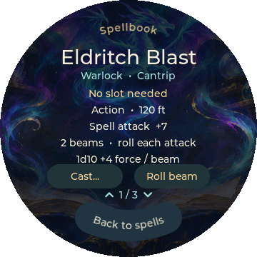

# D&D Companion

Your D&D Beyond character on a Waveshare ESP32-S3-Knob-Touch-LCD-1.8.
Open your character’s spells, equipped weapons and checks at the table.

**Character access.** Each player supplies individual D&D Beyond character
links. Import and refresh require a sheet that opens by link while signed out.
Private sheets and automatic account-wide character discovery are unsupported.

Save D&D Beyond character links, switch characters on the device, and refresh
over Wi-Fi. Play offline in English, Italian or Spanish. PDF import is planned.

## Play with firmware 0.1.5

Open a portrait to roll checks, saves and attacks with your own modifiers. Cast from your slots, track HP and death saves, or open **Pack** to drink a potion, use a scroll or pay in coins. **Turn** keeps your action, bonus action and reaction visible. Swipe the sheet to change shortcuts or tap the portrait for mixed dice.

- [Install or update your dial](https://colombod.github.io/dnd-companion/guide/v0.1.5/install.html) · [USB orientation checker](https://colombod.github.io/dnd-companion/usb/index.html)
- [Illustrated player manual](https://colombod.github.io/dnd-companion/guide/v0.1.5/index.html) · [Release features](https://colombod.github.io/dnd-companion/guide/v0.1.5/features.html) · [Rulebook coverage](https://colombod.github.io/dnd-companion/guide/v0.1.5/rules.html)
- [Firmware downloads](https://github.com/colombod/dnd-companion-firmware/releases/tag/v0.1.5) · [Hardware](docs/HARDWARE.md) · [Build from source](docs/PICKER.md)

MIT licensed.
