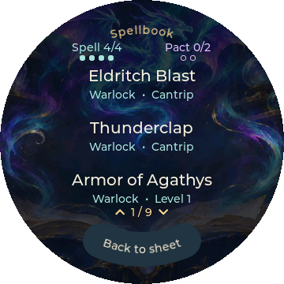

<!-- player-guide:start -->
# What can I do with my character?

## What’s new in 0.1.7

You can install this release over Wi-Fi from 0.1.6 and use Previous firmware to return to 0.1.6. Both paths preserve your characters, their saved play state and your Wi-Fi settings. The gameplay rules are the same as in 0.1.6.

## What works today

The dial follows the active character. Turn the ring or swipe to another saved character, tap the portrait to play, and keep using the cached sheet between Wi-Fi connections.

| At the table | On the dial |
| --- | --- |
| Bring your sheet | Scan the setup QR code, add up to 12 individual D&D Beyond links, edit or remove them, and crop optional character art on your phone. Sheets must open by link while signed out. [Phone setup](MANUAL.md#set-up-at-the-table) |
| Update a character | Check a linked sheet over Wi-Fi and review changes before accepting. Cached characters remain playable offline. [Refresh a sheet](MANUAL.md#refresh-and-play-offline) |
| Roll a check or save | Select one of 18 skills, six abilities or six saves. Choose advantage or disadvantage on the glass and spin to roll with the imported modifier. [Checks and saves](MANUAL.md#roll-a-check-or-a-save) |
| Build a mixed roll | Tap dice around the rim to add them. Hold to remove one every half second. Spin to throw the pool and inspect each result. [Dice tray](MANUAL.md#build-a-dice-pool) |
| Cast or attack | Browse the character’s spells and actions, review the modifier or save DC, choose a slot, and roll supported attacks and damage. Eligible Metamagic shows the point cost before casting. [Spellbook and equipment](MANUAL.md#look-up-spells-and-actions) |
| Track a fight | Adjust HP and temporary HP, make death saves, stabilize, and track your action, bonus action and reaction. Record received Guidance or Bardic Inspiration for an eligible roll. [Health](MANUAL.md#hit-points-death-saves-and-stabilization) · [Turn](MANUAL.md#track-your-turn) |
| Use your pack | Drink or give a healing potion, record a used scroll, adjust a stack or pay in coins. Confirm to spend and use Undo to reverse the latest transaction. [Pack and purse](MANUAL.md#use-your-pack-and-purse) |
| Spend and recover resources | Preview short and long rests, regular and Pact slots, and supported class counters. A Sorcerer can exchange slots and points. An eligible Forge Artificer can spend Flash of Genius or cast with Mapping Magic. [Sorcery Points](MANUAL.md#sorcery-points-and-metamagic) · [Artificer](MANUAL.md#playing-a-forge-artificer) · [Rests](MANUAL.md#short-and-long-rests) |
| Make the dial yours | Pick English, Italian or Spanish for controls and phone setup. Imported sheet text keeps its source language. [Language settings](MANUAL.md#choose-a-language) |
| Update and return | Check for a firmware offer, confirm the install, and use **Previous firmware** to return to the verified earlier version. [Install and restore](INSTALL.md) |

For your class or spell, see what the dial calculates and what your table resolves. [D&D editions and rule coverage](RULES.md)

Missing something your character does in play? Tell us your edition, the feature or item, and what you would like to do on the dial. [Request a feature on GitHub](https://github.com/colombod/dnd-companion/issues/new?template=player-feature.yml)
<!-- player-guide:end -->
