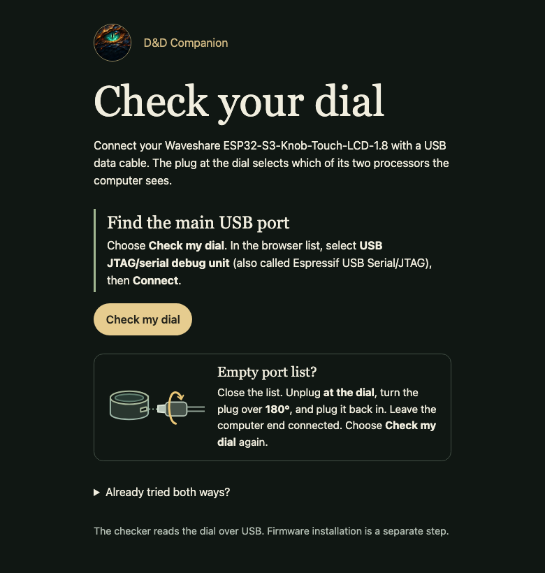
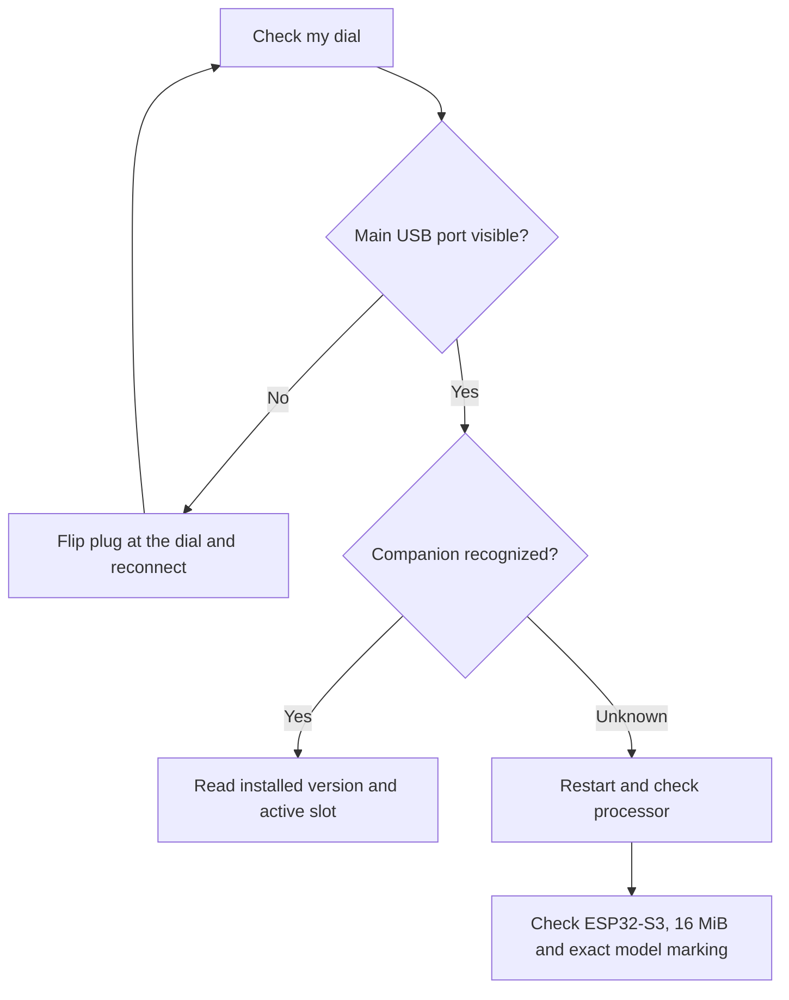
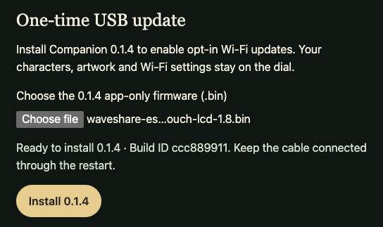
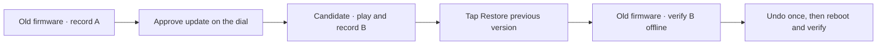
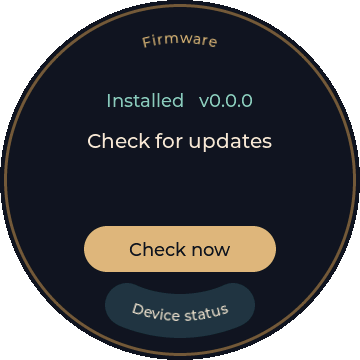
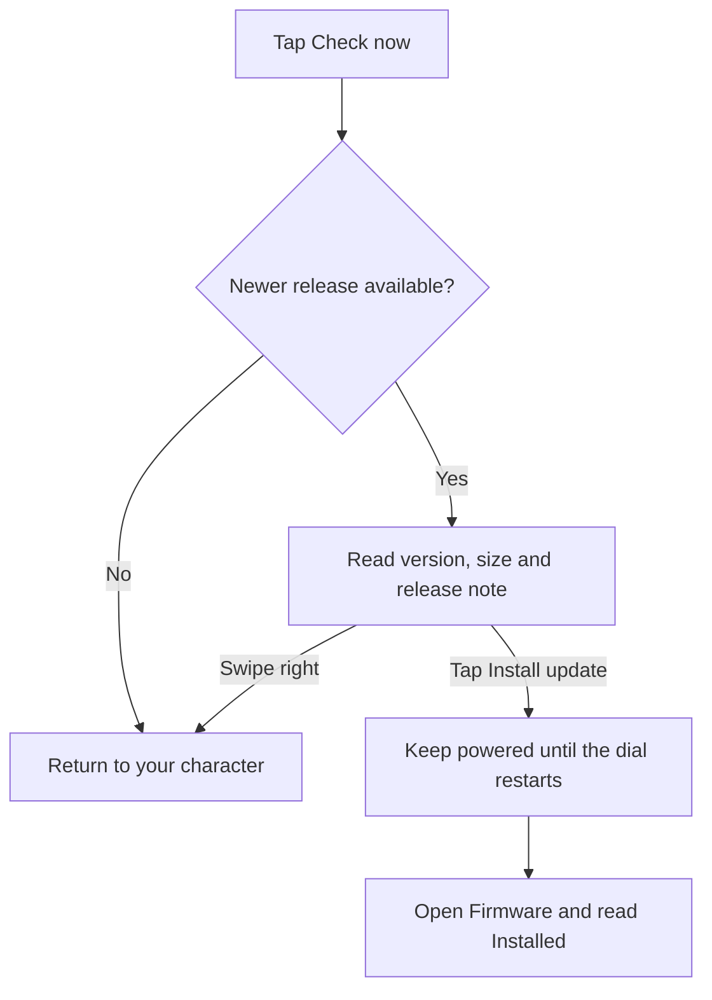
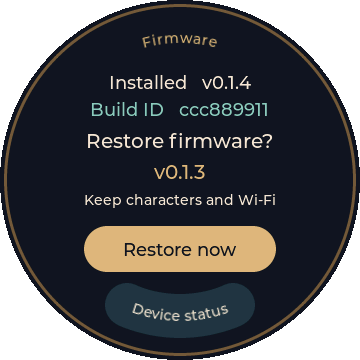

# Install and update your dial

**The first install uses USB. After that, the player chooses USB or Wi-Fi for each update.** The player guide includes a USB orientation checker and a preserving one-time update for the qualified 0.1.3 development build. Browser first-install on factory firmware is still in development. Release 0.1.5 supports player-initiated restore after the qualified Wi-Fi update from 0.1.4. [Installation routes and downloads](INSTALL.md)

## Check the USB connection

Open **Check USB** in the player guide using desktop Chrome or Edge. Plug a data cable into the dial, choose **Check my dial** and, if the browser asks, select **USB JTAG/serial debug unit** (Espressif USB Serial/JTAG) and **Connect**. On this Waveshare, the dial-end plug routes one way to the main ESP32-S3 and the other way to the second ESP32. [Waveshare USB routing](https://www.waveshare.com/esp32-s3-knob-touch-lcd-1.8.htm)



If the list is empty, close it. Leave the computer end connected. **Unplug at the dial, turn the plug over 180°, reconnect, then choose Check my dial again.** If both ways give an empty list, try a known data cable and a direct USB port. If the port appears but cannot open, close any serial monitor using it and try again.

**Cable orientation confirmed** means you can leave the plug this way. An existing Companion also shows its version, running slot and build ID when available. On a factory dial, choose **Restart and check processor**. Look for **ESP32-S3 · 16 MiB flash**, then match the model marking to **ESP32-S3-Knob-Touch-LCD-1.8**. Other boards share the same processor and flash capacity.

To run the checker from the source checkout, build its static files and serve only its output directory. Open **http://localhost:8765**. On Windows, use `py -3` in place of `python3`. The build verifies the pinned Espressif browser library. All serial traffic stays in the browser. [Web Serial](https://developer.chrome.com/docs/capabilities/serial) · [Espressif browser tool](https://espressif.github.io/esptool-js/)

```sh
python3 tools/build_usb_probe.py
python3 -m http.server 8765 --bind 127.0.0.1 --directory .build/usb-site
```



## One-time USB update to 0.1.4

1. Open **Check USB** and confirm the cable orientation. This update requires the 0.1.3 development build with ID `1a8dc714d` on the matching 16 MiB board. A previously paired dial can open directly.
2. Under **One-time USB update**, choose the qualified 0.1.4 app file, `waveshare-esp32-s3-knob-touch-lcd-1.8.bin`. The same verified image is available as [usb-bridge-0.1.4.bin](https://github.com/colombod/dnd-companion-firmware/releases/download/v0.1.5/usb-bridge-0.1.4.bin). The checker verifies the full SHA-256 and previews build `ccc889911`.
3. Choose **Install 0.1.4**. Keep the cable connected. The installer checks the running app, bootloader, partition map and both boot records. It writes and verifies the other application slot before selecting it for first boot.
4. Wait for **USB update verified**. Tap the dial’s top status arc, open **Firmware**, and match the two build IDs. Open each saved character and check that the dial reconnects to Wi-Fi.



A failed initial boot can fall back to the original app. The player-facing **Previous firmware** control requires a restore record created by a compatible Wi-Fi installation. For a return to the pre-USB build after a successful boot, retain the private USB recovery copy. Future Wi-Fi updates are opt-in under **Firmware → Check now**.

## Choosing an installation method

| Player's choice | Release design |
| --- | --- |
| First install over USB | Confirm the exact model, save and verify a private recovery copy on the computer, show which firmware will be replaced, then ask to install. The clean factory package contains the bootloader, partition map, boot selection and app. |
| Update over USB | Identify the running product, version and partition layout. Stage the compatible app in the inactive slot, verify it, then switch boot slots. Keep characters, artwork, Wi-Fi and session storage. A failed identification stops the update. |
| Update over Wi-Fi | Check on demand, preview the version, download size and changes, and install only after a second tap. USB remains available for each future update. |
| Restore the previous version | Show which verified version is available. Ask before switching slots. Before a release qualifies, exercise both a failed first boot and a deliberate restore after successful play, and reopen the saved characters on the restored build. |

Changes to the bootloader, partition map or saved data that prevent a round trip require a separately labeled **breaking USB migration** with a verified local backup and recovery instructions. Keep these builds out of the normal Wi-Fi feed. A flash backup may include Wi-Fi credentials, profiles and artwork. Keep recovery images on the player's computer.

## Qualify an update before publishing

Qualify a **particular installed version and candidate**. A pass for one pair covers only that pair. Start on the computer with the two source revisions, then run the passing pair on the exact Waveshare model using a private test feed. Keep the public feed unchanged throughout the test.

```sh
python3 tools/check_firmware_release.py
node --test tools/check_usb_probe.mjs tools/check_usb_update.mjs
python3 tools/check_restore_pair.py "$INSTALLED_REV" "$CANDIDATE_REV"
```

The last command compiles each revision's actual session code with a C++17 host compiler. It creates two synthetic characters in temporary storage. One casts before the update and again on the candidate. The previous version must read the remaining slot, undo the candidate's cast, and persist that undo through another restart. The other character's balance must stay correct. Each step starts a fresh process with the NVS value and FAT bank bytes written by the previous process.

| Host session test | Observed result |
| --- | --- |
| 0.1.3 → 0.1.3 and 0.1.2 → 0.1.2 | Both same-version controls preserved the second cast and Undo. |
| 0.1.0 → 0.1.3 → 0.1.0 | The forward read succeeded. After a save on 0.1.3, the restored reader showed 3 slots where 1 remained. |
| 0.1.1 → 0.1.3 → 0.1.1 and 0.1.2 → 0.1.3 → 0.1.2 | Both backward reads also reported 3 remaining instead of 1. All three older starting versions fail the reversible Wi-Fi update criterion for 0.1.3. |

### Physical acceptance



Use a spare dial or one approved for temporary firmware. Before the first write, take a fresh full-flash backup, verify it against that dial and keep it privately on the computer. Record the exact image hashes, version, active slot, boot validity and partition layout. Use two cached characters. Record their portraits and backgrounds, language, saved Wi-Fi, HP, Pack quantities, spell slots, turn state and available Undo. Keep these readings and any screenshots under `.local/`.

| Exercise | What counts as a pass |
| --- | --- |
| Check, decline and restart | The offer shows version, size and changes. Checking fetches only the notice. Declining and rebooting keep the old image, active slot and character state. |
| Approve the update | The candidate starts from the other app slot. Both sheets open offline. On one character, use a potion and record the resulting quantity, HP or turn effect and Undo. Confirm the other character's state. This is the expected state after restore. |
| Choose **Restore previous version** after successful play | The dial shows the correct previous version and asks for confirmation. Dismissing keeps the candidate. Confirming works offline. After reboot, check the old version and slot, reopen both sheets, confirm the new play state, then use Undo once and power-cycle. Reconnect to the saved network without reentering its password. A USB reflash or reimport cannot pass this step. |
| Interrupt an update | In separate runs, serve a wrong-board manifest, a bad digest and a truncated image. Interrupt Wi-Fi and reset the dial partway through a valid transfer. In every case, reboot and verify that the current image and characters work, then retry a good image. Only offer Restore when its target remains intact. |
| Fail the candidate's first boot | On the test unit use a fault-injection build that resets **before** it marks itself healthy. Record that the bootloader returns to the previous slot without player action and both saves still open. Repeat the normal successful route with the release candidate's exact bytes. |

For browser USB qualification, separately exercise first install on a factory-state unit and a preserving update on a populated unit. Record OS and browser for each supported platform. Verify that the wrong USB connection and an unknown partition layout cannot start a write. Restore the tester's original firmware and data after the trial and verify against the pre-test record.

**Release decision.** Record pass, fail or untested for each starting version, with the device status before and after each case. A missing restore control, a fallback to a default save, or a required USB rescue fails the reversible OTA path. The original 0.1.3 build confirms a displayed frame and has no restore control. The 0.1.4 candidate also opens the saved catalog and verifies each present session before confirming a pending boot. A character who has never played locally can have an empty session. [Espressif first-boot confirmation and rollback](https://docs.espressif.com/projects/esp-idf/en/stable/esp32s3/api-reference/system/ota.html)

### Pre-release hardware qualification · 27 November 2026

Tests used one populated Waveshare ESP32-S3-Knob-Touch-LCD-1.8, S3 silicon revision 0.2, two 3 MiB application slots and a private certificate-checked HTTPS feed. The original 0.1.3 image uses the old public feed. A temporary 0.1.3 bootstrap (`f3e7795d4`) accepted format 2 and recorded the exact previous image before selecting the candidate. The 0.1.4 candidate (`ccc889911`) used the normal release build and trust store. Its 2,369,344-byte application image had SHA-256 `08bbb9b88ae7c3328d212b3bdc16a4c6153defb945cc97b3387f9a857bc44dcc`.

| Exercise | Physical observation |
| --- | --- |
| Manifest and opt-in | A format-1 reader rejected format 2. The format-2 reader rejected a different board and an unlisted starting version. Declining the compatible offer requested only the manifest. |
| Interrupted image | A short response length, a dropped connection after 256 KiB and a bad SHA-256 each produced an error. Resetting after the screen reported 5% left the original app intact. |
| Unhealthy first boot | A separate fault image (`47449c7d5`) reset before confirmation. The dial booted the previous app by itself. Reading the boot records afterward showed the test image aborted and the previous slot valid. The two character records, Wi-Fi record and data partition matched the pre-failure checkpoint. |
| Deliberate restore | The approved `ccc889911` download ran in app0. A potion use changed the stock from three to two. With the private feed shut down, dismissing Restore kept app0. Confirming it booted `f3e7795d4` in app1. Both cached sheets opened, character and network records matched, and the data partition matched the post-use checkpoint byte for byte. Undo on the restored build returned the potion count to three. |
| Return the tester’s dial | After proving the on-dial restore and Undo, a separate USB cleanup returned the exact original build (`1a8dc714d`) and original Undo history. All 16 MiB matched the verified pre-test backup before reboot. Both sheets reopened with their original resources. |

**One-time player-guide USB update.** On macOS 27.2.1 with Chrome 158.0.8127.89 and the populated dial above, the guide recognized `1a8dc714d` in app1. After explicit confirmation it installed `ccc889911` in app0. The dial marked the candidate valid. The Firmware screen, the browser readback and the release artifact agreed on the build ID. All 15 logical player settings and save records and the complete data partition matched the private pre-update backup. Both sheets reopened and the saved network reconnected. The old app and its valid boot record were independently verified in place. During a preliminary attempt Chrome exited; a separate ROM read found both slots, both boot records and the player records intact before retry.

The original format-1 firmware needs a preserving USB update to use this path. Other browser/OS combinations, loss of the Wi-Fi association during a manual restore and other starting builds need their own qualification. Keep recovery images and per-character evidence on the tester’s computer.

### Public release qualification for 0.1.5

On 27 November 2026 the dial on 0.1.4 (`ccc889911`, app0) retrieved the public GitHub offer. Dismissing the offer left the old firmware running. Confirming the offer installed 0.1.5 (`95a184a82`, app1). **Previous firmware → Restore now** returned the dial to `ccc889911`. Both cached sheets reopened on both builds. All 15 player records, the full user filesystem, inventory, health, turn state and Undo matched the verified pre-update checkpoint. The saved network reconnected after reboot. Independent flash reads confirmed both application images and the bootloader’s final valid and rejected slot states.

The released 2,369,344-byte application has SHA-256 `7c7d387c30f4f97753b836a22d9ca3e30af01b1a9d7bc7c49ffd2cc1cf182879`. The public offer accepts 0.1.4. The first USB installation has a separate qualification below.

### Factory USB qualification for 0.1.5

On 27 November 2026, a Waveshare ESP32-S3-Knob-Touch-LCD-1.8 was backed up in full and loaded with Waveshare’s `WX-ESP32S3-KNOB_V1.2.bin` main-processor demo. The 16 MiB factory image was verified against flash. Chrome 158 on macOS 27.2.1 identified **ESP32-S3 · 16 MiB flash** using the published checker files served on localhost with an existing Web Serial grant. The public-site port chooser was outside this run.

| First-install path | Physical result |
| --- | --- |
| Original tagged guide, locally built app and stock Arduino boot selector | The empty picker opened. The running slot reported `validity=-1`, which prevents Wi-Fi installation. |
| Factory backup restored, then the prepared USB files from the [corrected guide](INSTALL.md#first-installation-on-macos) | The distributed app `95a184a82` booted in app0 with an empty library. Its own health check confirmed the slot (`validity=2`). The browser and the dial displayed the same build ID. |
| Restore the test player’s data and reboot | All 15 logical player records and all 10,354,688 filesystem bytes matched the original backup. Both character sheets, health, inventory, turn state and Undo screens matched the original captures pixel for pixel. The saved Wi-Fi reconnected and the dial reported **Up to date** from the public release feed. |

The preparation script marks the initial app as new. The bootloader requests verification on first boot, and the app confirms its own readable catalog. A first install has no previous Companion to select. [Espressif OTA lifecycle](https://docs.espressif.com/projects/esp-idf/en/stable/esp32s3/api-reference/system/ota.html)

## Check for a Wi-Fi update on the dial

On the picker or character sheet, tap the top Wi-Fi and power arc. Open **Firmware → Check now**. The dial retrieves a small release notice over the saved Wi-Fi network. When a newer version is available, it shows the version, download size and publisher's note. Swipe right to keep playing, or tap **Install update** and leave the dial powered through the restart. Checking and installing are separate taps. The player can play offline between updates.



Read **Installed** at the top. The **v0.0.0** in this device capture was an updater test build. Your dial shows its own version here. Compare it with the [rulebook coverage for 0.1.5](RULES.md#rulebooks-and-expansions).

On builds with **Build ID**, record it alongside the installed version before and after an update or restore. The USB connection checker reports the same ID. To match it to a build artifact, run `esptool --chip esp32s3 image-info application.bin` on the computer and compare the first nine hexadecimal characters of **ELF file SHA256**. The release manifest separately verifies the complete downloadable image. [Find the build information on the dial](MANUAL.md#update-the-dial-over-wi-fi)



## Restore the firmware you were using

Open **Device status → Firmware → Previous firmware**. Check the version, then tap **Restore now**. Swipe right or tap the return arc to cancel. After restart, check **Installed** and the **Build ID**. Open your character and continue from the last saved action, including actions taken on the newer firmware.



The control appears after a compatible update when the other slot still contains the verified previous image. The dial checks its recorded identity and digest before switching slots. Restore uses the copy on the dial and requires no download. Starting another installation can reuse that slot.

## First installation and recovery

An existing dial needs one USB installation of an OTA-capable build. The standard 16 MiB partition table has two 3 MiB application slots. The updater streams into the inactive slot and selects it for the next boot only after verifying the expected byte count, SHA-256, embedded product and version, and ESP image. A failed transfer can be retried from **Check now**. Firmware version numbers increase numerically, including across 0.9.0 → 0.10.0.

Personal settings, character summaries, portraits and play state live in separate NVS and FAT partitions. Wi-Fi packages contain only the application image and release metadata. Both versions must be able to reopen the saved state after a forward update and a restore. The rollback-enabled bootloader can return to the previous image on reset if the new app fails before acknowledging its first working screen. In 0.1.3 a later gameplay bug requires USB recovery or a corrective release. For a manual USB repair, retain the verified backup and determine the running slot from the console's `STATUS` command before writing an application. [First USB installation](PICKER.md) · [Espressif OTA lifecycle](https://docs.espressif.com/projects/esp-idf/en/stable/esp32s3/api-reference/system/ota.html)

## USB-only feed migration

0.1.6 uses the main source repository for its application and update manifest. Its empty `otaFrom` list requires USB installation. The old firmware repository keeps the downloads used by existing installations and can publish a compatibility manifest directing older firmware to USB. Compatible releases on the new feed list their supported starting versions explicitly. [Player installation guide](INSTALL.md)

**Breaking releases use USB.** Publish the app and a format-2 manifest with an empty `otaFrom` list. Document the supported starting builds, the backup procedure and the preserving USB route. For a later compatible release, explicitly list the migrated version only after checking its save and restore behavior. Firmware 0.1.7 accepts 0.1.6. The legacy feed continues to offer the 0.1.6 USB migration notice.

### Physical migration and restore qualification

On 27 November 2026, a populated 16 MiB Waveshare ESP32-S3 dial started on release 0.1.5 in app0. The complete device was backed up and verified before installing the main repository’s published 0.1.6 binary over USB. The checker reported build `dcf978eee` healthy in app1. Wi-Fi reconnected on a subsequent restart. The firmware reached the new production feed.

The new feed offered 0.1.7. The tester dismissed the first offer, then confirmed a new offer. The dial installed build `78c0e14f6` over Wi-Fi in app0. **Previous firmware** returned it to 0.1.6. Independent flash readback verified the application images, boot records, all 15 logical player records and the entire 10,354,688-byte character filesystem after USB migration, OTA installation and restore. Two sheets, health, inventory, turn state and Undo matched their original screen captures on both versions.

## Prepare a release

Use the pinned tools from the macOS build guide. Set `firmware/VERSION` to a new three-part numeric version. Build the assets from a checkout of the source revision being released. The release option suppresses local character seeds, uses the production certificate bundle and checks the resulting app against the slot budget and product identity.

```sh
python3 tools/build_picker.py --release-note 'Describe the change a player will notice.'
```

The two distributable files are `.build/releases/<version>/companion.json` and `waveshare-esp32-s3-knob-touch-lcd-1.8.bin` in the same directory. The manifest pins the exact versioned image URL, size and SHA-256. Keep the versioned asset immutable once offered to devices. For a correction, issue a higher patch version.

To offer a reversible update, add `--ota-from X.Y.Z` for each starting version that passed the complete qualification. With no qualified starting versions the manifest offers no Wi-Fi upgrade. Format 2 prevents the original 0.1.3 and older updaters from installing a candidate that requires a restore record. Those dials need a preserving USB bootstrap before joining the new OTA path.

## Prepare the distribution feed

The default feed for firmware 0.1.6 and later is `https://github.com/colombod/dnd-companion/releases/latest/download/companion.json`. Publish the manifest and app as assets on the same source release. The legacy repository retains older downloads and USB migration notices. Devices use signed-out HTTPS for release discovery and installation.

```sh
version=$(cat firmware/VERSION)
dist=".build/releases/$version"
repo=colombod/dnd-companion
gh release create "v$version" "$dist/companion.json" "$dist/waveshare-esp32-s3-knob-touch-lcd-1.8.bin" \
  --repo "$repo" --draft --title "Dial firmware $version" --notes-file release-notes.md
```

Supply your own release notes file. Leave the release in draft until the physical upgrade, interruption, restore and saved-data checks pass on its supported upgrade paths. The dial uses HTTPS with certificate validation for both requests. The checked manifest identifies the exact binary installed after review. Release authenticity relies on the HTTPS publisher and its account. The SHA-256 checks transfer integrity.

For another HTTPS host, build the initial USB image **and every subsequent OTA image** with `--feed-url https://your-host.example/dial/companion.json`. For release packaging also supply `--image-url https://your-host.example/dial/v1.2.3/waveshare-esp32-s3-knob-touch-lcd-1.8.bin` and the release note. Upload the versioned image first and replace the feed manifest last. Hosts must allow a signed-out GET and supply a certificate trusted by the device. The Wi-Fi setup needs network time for certificate validation. [GitHub release asset access](https://docs.github.com/en/rest/releases/assets#get-a-release-asset)
