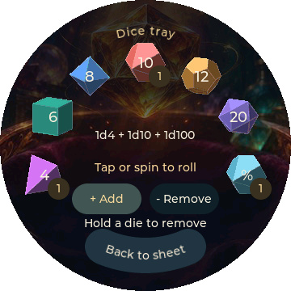

# The physical dial

Every screen in this project targets the **Waveshare ESP32-S3-Knob-Touch-LCD-1.8**.
This profile describes the published board. Match the revision and validate its
peripherals on the player's unit when firmware work starts. The reference product,
the similarly named 1.85-inch board and the 1.8-inch AMOLED board have different
hardware. [Waveshare wiki](https://www.waveshare.com/wiki/ESP32-S3-Knob-Touch-LCD-1.8)
· [Product specifications](https://www.waveshare.com/esp32-s3-knob-touch-lcd-1.8.htm)

## Capabilities that shape the interface

On this face, tap a die on the glass to add it, hold the same die to remove one every half-second, then spin the physical ring to roll. The center displays the expression while the rim remains available for touch. [Worked roll and result](MANUAL.md#build-a-dice-pool)

| Part | Evidence for this model | Design consequence |
| --- | --- | --- |
| 1.8-inch round LCD | 360 × 360, 262K panel colors, QSPI. Waveshare's product table names ST77916. Schematic sheets 1 and 2 show the QSPI and backlight wiring. | Compose at native size, clip to a circle and check controls against its circumference. Use RGB565 for budgeting. Confirm the panel init sequence on the unit. |
| Glass and ring | CST816-family capacitive touch, interrupt and reset. Two encoder A/B pairs serve the two chips. The S3 pair uses GPIO8/A and GPIO7/B. | Design for one finger and one user-facing rotating ring. Tap a target directly. Turn to browse or adjust, spin to roll on an armed screen. Power and BOOT are separate hardware controls. |
| Motion | All five vendor schematic sheets were inspected. They show no accelerometer or gyroscope. DRV2605L drives the motor. | Backgrounds stay still. Tilt, shake-to-roll and decorative ring movement are outside the interaction design. |
| Haptics | DRV2605L on the same I²C lines as touch, driving the motor on sheet 5. | A brief optional pulse confirms a committed action or settled roll. Queue the effect without delaying touch handling. Every cue also has a visible result. |
| Processors and memory | ESP32-S3R8, up to 240 MHz, 512 KiB on-chip SRAM, 8 MiB PSRAM and 16 MiB external flash. Separate ESP32-U4WDH with its own memory and encoder inputs. | Budget the UI on the S3 alone. The second chip's RAM is separate. Leave internal DMA-capable memory for panel transfers and measure heap while Wi-Fi is active. |
| Connectivity | 2.4 GHz Wi-Fi and Bluetooth LE on the S3. The companion ESP32 also supports Classic Bluetooth. | Wi-Fi retrieves linked sheets. Cached play works offline. Bluetooth setup is optional. A second radio adds no requirement for the initial experience. |
| Sound | Digital microphone, PCM5100A-family stereo DAC and a 3.5 mm output. Sheet 5 shows the audio switch. | Play, roll and recover with the speaker disconnected. Haptic and visible cues suffice. |
| Storage and power | Onboard flash, TF/microSD slot, USB-C, battery connector, charging management, battery ADC and backlight control. Battery inclusion varies by SKU. | Store the core play state in flash, treat the card as optional, and verify offline boot with the card removed. Dim at idle. Verify the actual battery before quoting runtime. |

The vendor schematic archive has five images covering LCD/power, S3, second ESP32,
other peripherals and DAC/haptics. Its reviewed SHA-256 is
`baa5ac1bf75fbbd86a8135b123ff498bd7db4a5c68184481db6b82cadbaca0e5`.
[Exact-board schematic archive](https://files.waveshare.com/wiki/ESP32-S3-Knob-Touch-LCD-1.8/ESP32-S3-Knob-Touch-LCD-1.8-schematic.zip)

GPIO1 samples the supply rail through two 10 kΩ resistors (R62/R63 on sheet
4). The vendor ADC demo doubles the calibrated ADC voltage. That measurement
can rise to the USB supply voltage while plugged in. The S3 native USB/JTAG
host-presence signal identifies a connected USB host. The schematic exposes
no charger-status or fuel-gauge signal to the S3.

## Pack and turn storage

The pack reads its item names and source quantities from the character’s existing 96 KiB book bank. Play changes and one-step Undo share a 392-byte session record per bank in the 0.1.3 build. Two FAT files hold alternate records. A save rereads the inactive file and verifies its checksum before changing the eight-byte NVS pointer. The previous bank remains active if any step fails. A verified record is cached in RAM for redraws. Older sessions migrate on the next successful write. The Pack and Turn screens reuse the existing backdrop and fonts.

## Application update budget

The 16 MiB build reserves two 3 MiB application slots at 0x10000 and 0x310000. The OTA selector lives at 0xe000, separate from NVS at 0x9000 and FAT at 0x610000. On-device updates stream the app into the inactive slot with bounded memory. The release builder and the installer both enforce the slot budget. [Firmware updates](FIRMWARE-UPDATES.md)

## Graphics and working memory

The dragon eye, shield, grimoire and amber dice are prepared off-device. Each is a single
native-size baseline JPEG. The device can decode a face on entry and reuse it
while redrawing values or controls. The original art stays out of the device
bundle. Keep expensive effects in the painting. A small result highlight or
boot flourish can play once, with a still option.

| Working item | Explicit project budget or calculation |
| --- | --- |
| Illustrated face on flash | At most 40 KiB per 360 × 360 JPEG. The three play faces use 84,778 bytes. The opening dragon scene uses a further 39,025 bytes. |
| Dice around the rim | Seven 52 × 52 die images share one 364 × 52 indexed atlas. It occupies 4,894 bytes on disk against a 12 KiB design budget. Together with the three faces, the assets use 89,672 bytes. Keeping all indices decoded costs 18,928 bytes plus palette and transparency data. Rendering needs only a fixed image and a count overlay per die. |
| One decoded face | 360 × 360 × 2 = 259,200 bytes in RGB565 (253.125 KiB). Keep one resident in PSRAM. Scanning through spells reuses the same book illustration. |
| Display transfer strips | The driver uses two 360 × 24 × 2 strips totaling 34,560 bytes in internal DMA-capable RAM. |
| Art plus two strips | 293,760 bytes across the two heaps. Decoder workspace, UI objects, fonts, stacks, TLS and the character cache are additional. A full extra draw buffer would cost another 259,200 bytes. |
| Library pictures | One 128 × 128 RGB565 linked icon uses 32,768 bytes decoded, reused across characters. Its rounded mask is centered at (180, 180). The one replaceable 360 × 360 background uses the existing face buffer. The phone crops and encodes a baseline JPEG for each layer. Firmware rejects wrong dimensions and files over 12 KiB (icon) or 40 KiB (background). It removes the old file after committing the replacement. |
| Imported sheets | Parse only the needed fields with bounded input, depth and cache sizes. Keep the previous valid sheet during refresh. Parse PDFs on the setup device. Size the firmware, cache and any OTA partitions using the partition table. |

Picker status and actions use opposite 90° rim sectors. Their touch targets span radii 132–180 pixels. The central selection disk has a 116-pixel radius. The intervening band prevents ambiguous taps. Rim captions sit on a 158-pixel radius. Upper build details, character name, class levels and cache status use radii of 131, 93, 106 and 130 pixels respectively. The name starts at 36 px. Lower captions read left to right. The class arc allows 294 pixels of text along the curve, spanning up to 159° at 20, 18 or 14 px. The game title and rounded return caption use two additional masks. All eight PSRAM masks together are bounded at 133,543 bytes. The return control follows a radius of 136 px, is 44 px thick and leaves 22 px between its outer edge and the glass.

The build converts the seven tray tokens into 9,912 bytes of indexed flash sprites. The animated d20 uses 32 precomputed 104 × 104 frames with 4-bit pixels and one 64-byte palette per frame, totaling 175,104 bytes in flash. LVGL swaps the central image at most once per 36 ms. The illustration runs for 390–770 ms and uses the existing transfer strips. Spell and action data live in a bounded 96 KiB-per-bank file per character. A reviewed refresh switches banks when the new sheet is committed.

## How a change earns device support

1. **Asset check.** Run `python3 tools/check_device_art.py` from the repository. It checks file size, native dimensions and baseline JPEG format. A desktop framebuffer or a storyboard montage is a review artifact.
2. **Screen review.** View the actual 360-pixel circle. Check every target at its widest label, the art behind the text, focus changes and the return path. Aim for touch targets at least 44 × 44 display pixels. Inspect the circle geometry and check overlapping hit regions. Test tapping and holding a rim die, then swiping from that same location. Only one edit or navigation action should commit.
3. **Input and rules review.** Exercise a fast and a slow spin in both directions, a swipe crossing a button and a spin that coasts into a result. One throw produces one result. Normal, advantage and disadvantage are touch choices. Browsing, assigning targets, rolling damage and reopening results spend zero extra slots.
4. **Physical bring-up.** Record the board marking, display initialization, build and partition map. Verify the full circle, touch axes and edges, detents and direction, motor with sound disconnected, backlight, sleep and wake. Verify persistence after power cycling.
5. **Worst-case session.** Start a Wi-Fi refresh while browsing spells and rolling, then switch characters and interrupt the network. Record minimum free internal RAM, largest DMA-capable allocation, PSRAM high-water usage, input-to-feedback latency, frame time and boot-to-cached-sheet time. Check for missed turns, stale touch events, resets and incorrect cached state. Also try a missing card and an oversize portrait.

Bring-up on the connected USB unit verified the ESP32-S3 (silicon revision 0.2), 16 MiB flash, 8 MiB PSRAM, panel transfers, capacitive touch, ring detents, haptic acknowledgement and direct Wi-Fi sheet retrieval. The player confirmed the displayed portrait and physical pulse on the initial picker. USB presence and rail voltage are available; actual charging state is unavailable. PCB revision, battery discharge calibration, daylight readability and worst-case play-loop timing remain unverified.
