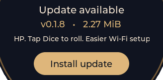

# Install or update Companion 0.1.8

**From 0.1.7 or 0.1.6, you can install 0.1.8 over Wi-Fi on the Waveshare ESP32-S3-Knob-Touch-LCD-1.8.** You choose when to install. Your characters, local play state, artwork and saved networks stay on the dial. After the update, **Previous firmware** returns you to the version you came from.

## Choose your starting point

Tap the top status arc and open **Firmware** to read your installed version and build ID.

| Your dial | Next step |
| --- | --- |
| Companion 0.1.7 · `78c0e14f6` or 0.1.6 · `dcf978eee` | Follow the [Wi-Fi update](#wi-fi-update-and-restore) below. Keep the dial powered through the restart. |
| Companion 0.1.8 · `e4a9e8b38` | Open the [gesture guide](MANUAL.md#gesture-reference) to play. |
| Companion 0.1.5 · `95a184a82` | Follow the [USB migration to 0.1.6](#usb-migration-for-015), then update to 0.1.8 over Wi-Fi. |
| Companion 0.1.4 · `ccc889911` | Use the USB checker with the [0.1.5 app image](https://github.com/colombod/dnd-companion-firmware/releases/download/v0.1.5/waveshare-esp32-s3-knob-touch-lcd-1.8.bin), then follow the 0.1.5 steps. |
| Factory demo or development 0.1.3 | Start with the [first-install guide](https://colombod.github.io/dnd-companion/guide/v0.1.5/install.html). For 0.1.3 the USB checker first offers the 0.1.4 bridge. |

## Wi-Fi update and restore

1. Connect the dial to your saved table Wi-Fi. On the character sheet or picker, tap the top status arc → **Firmware → Check now**. Review the 0.1.8 offer. Swipe right to leave it, or tap **Install update**.
2. Keep the dial powered while it downloads, verifies the app and restarts. Open **Firmware** again and check for **Installed v0.1.8** and build **e4a9e8b38**.
3. To go back, tap **Previous firmware**. Check the version in the preview, then tap **Restore now**. The dial restarts into its previous app and opens the same local saves. From 0.1.7, look for build **78c0e14f6**. From 0.1.6, look for **dcf978eee**. You can install 0.1.8 again through **Check now**.

| Accept the update | Go back to the previous app |
| --- | --- |
|  |  |
| Checking lets you read the offer before the download starts. | Returning uses the earlier app already on the dial. Your current play state stays available. |

## USB migration for 0.1.5

1. Keep the dial powered. Use a full verified recovery backup if you need a copy of the entire dial. The [macOS backup instructions](https://colombod.github.io/dnd-companion/guide/v0.1.5/install.html#first-installation-on-macos) describe the read and verification steps.
2. Download the [0.1.6 app-only firmware](https://github.com/colombod/dnd-companion/releases/download/v0.1.6/waveshare-esp32-s3-knob-touch-lcd-1.8.bin). Its SHA-256 is `d32437730e92bad4e3a776b7d2268885277e1d00bd7654b1ac178e3e42bd4059`.
3. Open [Check USB](https://colombod.github.io/dnd-companion/usb/index.html) in desktop Chrome or Edge. Choose **Check my dial** and select the Espressif USB JTAG/serial port. If it is missing, flip the plug 180° at the dial. If a previous update check is still displayed, restart the dial and check again.

   

4. Once the checker identifies 0.1.5, select the downloaded file. Check the preview for **0.1.6 · Build ID dcf978eee**, then choose **Install 0.1.6**. Keep the cable connected until **USB update verified** appears. The checker verifies the source, writes the inactive slot, checks it and starts the dial's first-boot health check.
5. Open the dial’s top status arc → **Firmware** and compare the build ID. Open your usual character, then return to **Firmware → Check now** to reach the main repository over Wi-Fi.
