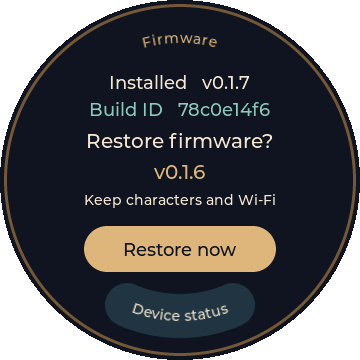

# Install or update Companion 0.1.7

**0.1.7 updates over Wi-Fi from 0.1.6 on the Waveshare ESP32-S3-Knob-Touch-LCD-1.8.** From 0.1.5, take the USB-only 0.1.6 migration first. That migration switches the dial to this project’s GitHub Releases. Characters, portraits, play state and saved networks stay on the dial.

## Choose your starting point

| Your dial | Next step |
| --- | --- |
| Companion 0.1.5, build `95a184a82` | Follow the preserving USB update to 0.1.6 below, then update to 0.1.7 over Wi-Fi. |
| Companion 0.1.6, build `dcf978eee` | Use the Wi-Fi update below to install 0.1.7. |
| Companion 0.1.4, build `ccc889911` | Use the USB checker with the [0.1.5 app image](https://github.com/colombod/dnd-companion-firmware/releases/download/v0.1.5/waveshare-esp32-s3-knob-touch-lcd-1.8.bin), then repeat with 0.1.6. |
| Companion 0.1.7, build `78c0e14f6` | Open the [player manual](MANUAL.md) to resume play. |
| Factory demo or development 0.1.3 | Follow the [0.1.5 installation guide](https://colombod.github.io/dnd-companion/guide/v0.1.5/install.html) for your starting build. For 0.1.3 the checker first offers the 0.1.4 bridge. |

## Preserving USB update

1. Keep the dial powered. Use a full verified recovery backup if you need a copy of the entire dial. The [macOS backup instructions](https://colombod.github.io/dnd-companion/guide/v0.1.5/install.html#first-installation-on-macos) describe the read and verification steps.
2. Download the [0.1.6 app-only firmware](https://github.com/colombod/dnd-companion/releases/download/v0.1.6/waveshare-esp32-s3-knob-touch-lcd-1.8.bin). Its SHA-256 is `d32437730e92bad4e3a776b7d2268885277e1d00bd7654b1ac178e3e42bd4059`.
3. Open [Check USB](https://colombod.github.io/dnd-companion/usb/index.html) in desktop Chrome or Edge. Choose **Check my dial** and select the Espressif USB JTAG/serial port. If it is missing, flip the plug 180° at the dial. If a previous update check is still displayed, restart the dial and check again.

   

4. Once the checker identifies 0.1.5, select the downloaded file. Check the preview for **0.1.6 · Build ID dcf978eee**, then choose **Install 0.1.6**. Keep the cable connected until **USB update verified** appears. The checker verifies the source, writes the inactive slot, checks it and starts the dial's first-boot health check.
5. Open the dial’s top status arc → **Firmware** and compare the build ID. Open your usual character, then return to **Firmware → Check now** to reach the main repository over Wi-Fi.

## Wi-Fi update to 0.1.7 and restore

1. With 0.1.6 installed and your dial connected to Wi-Fi, open the top status arc → **Firmware → Check now**. Review the **0.1.7** offer. Swipe right to decline or tap **Install update** to accept.
2. Keep the dial powered through its restart. Open **Firmware** and check **Installed v0.1.7**, build **78c0e14f6**. Open your characters to resume play.
3. To return to 0.1.6, choose **Previous firmware → Restore now**. After restarting, confirm build **dcf978eee**. You can install 0.1.7 again from **Check now**.

| Install over Wi-Fi from 0.1.6 | Return to 0.1.6 from 0.1.7 |
| --- | --- |
|  |  |

The player chooses when to check and install. A release that requires USB shows **USB update required** when offered to an incompatible starting version. After a compatible Wi-Fi installation, **Previous firmware → Restore now** brings back the previous firmware with your current character saves. A USB migration has no player-initiated OTA restore receipt.
