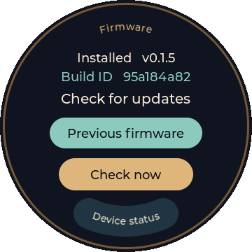
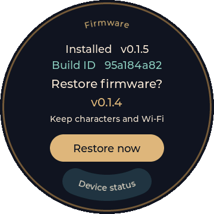
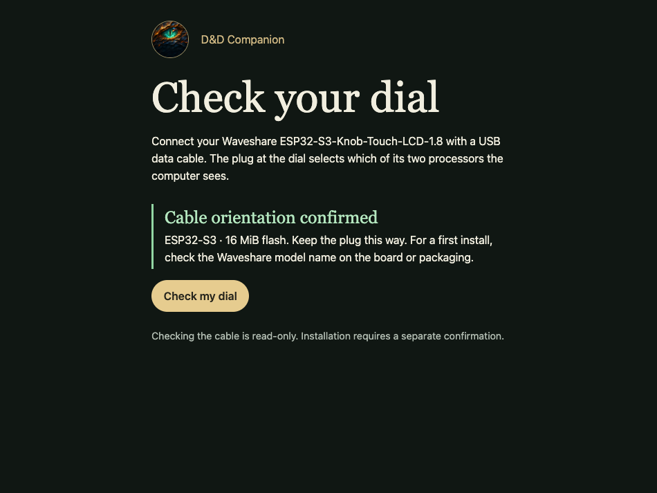
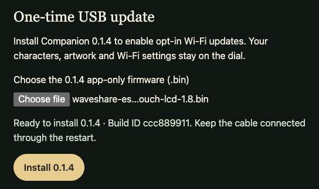
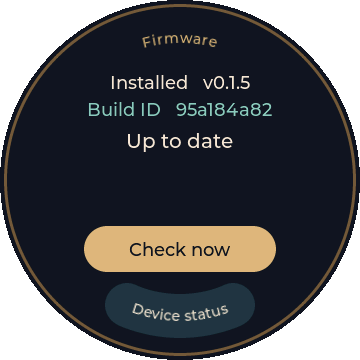

# Install, update or restore your dial

This guide is for the **Waveshare ESP32-S3-Knob-Touch-LCD-1.8**. Tap the top status arc and open **Firmware** to see your installed version. The distributed Companion 0.1.5 build ID is **`95a184a82`**.

| What the dial shows | Where to start |
| --- | --- |
| Companion 0.1.4, build `ccc889911` | [Update over your saved Wi-Fi](#update-over-wi-fi). This is the physically tested route to 0.1.5. |
| Companion 0.1.5 | [Add characters and Wi-Fi with your phone](MANUAL.md#set-up-at-the-table), or [open the player manual](MANUAL.md). |
| Development 0.1.3, build `1a8dc714d` | [Use the preserving USB update](#update-an-older-companion-over-usb), then update over Wi-Fi. |
| Factory demo | [Identify the main USB port](#check-the-usb-cable), then follow the [first installation on macOS](#first-installation-on-macos). |

## Update over Wi-Fi

1. Connect to the 2.4 GHz network saved in **Phone setup**. Keep the dial powered. Open **Firmware → Check now**.
2. Review the version and download size. Swipe right to decline or tap **Install update**. The dial verifies the download in its other application slot and restarts.
3. Open **Firmware** again. For the 0.1.4 to 0.1.5 update, look for **Installed v0.1.5** and **Build ID 95a184a82**. Open your characters to resume play.

## Restore the previous firmware

Open **Firmware → Previous firmware**. Read the version on the confirmation screen. Swipe right to cancel or tap **Restore now**. After the restart, open **Firmware** again. A dial updated from build `ccc889911` returns to that build. Characters, item counts and Wi-Fi use the saves already on the dial. The restore runs from the local copy.

| Find the previous firmware | Confirm the version |
| --- | --- |
|  |  |

The control appears after a compatible Wi-Fi update records a verified previous image. Opening **Check now** only checks for an offer. Starting another installation can reuse the other slot.

## Check the USB cable

Open **Check USB** in the player guide in desktop Chrome or Edge. Connect a data cable and choose **Check my dial**. If prompted, select **USB JTAG/serial debug unit**. If the port list is empty, unplug **at the dial**, turn that plug over 180° and reconnect. Keep the computer end in place. Close Arduino Serial Monitor if it has the port open.


A Companion reply confirms the orientation. For a factory demo choose **Restart and check processor**. Confirm **ESP32-S3 · 16 MiB flash** and the exact model on the board or packaging.



## Update an older Companion over USB

For development build `1a8dc714d`, the checker offers **One-time USB update**. Choose the [verified 0.1.4 bridge image](https://github.com/colombod/dnd-companion-firmware/releases/download/v0.1.5/usb-bridge-0.1.4.bin). Check for target build `ccc889911`, choose **Install 0.1.4**, and keep the cable connected until **USB update verified** appears. Compare the build ID on the dial. You can now follow the [Wi-Fi update steps](#update-over-wi-fi).



The browser offers this preserving install only for the identified starting build and partition layout. For another installed build, keep a verified recovery backup before planning a USB migration.

## First installation on macOS

Use this procedure on a Waveshare dial running its factory demo. Chrome identifies the main processor. The Mac writes the complete firmware over USB. Allow several minutes for the factory backup and keep the cable connected through the restart. For a dial that already holds characters, use the preserving update route above.

1. Install Git, Python 3.10 or later, and Arduino IDE 2 with **esp32 by Espressif Systems 4.0.0** in Boards Manager. Use a fresh checkout of the release for its backup and USB console tools.

   ```sh
   git clone --branch v0.1.5 https://github.com/colombod/dnd-companion.git
   cd dnd-companion
   ESPTOOL="$HOME/Library/Arduino15/packages/esp32/tools/esptool_py/5.3.1/esptool"
   ```

2. Release the browser connection. Set `DIAL_PORT` to the main serial port you identified with the checker, for example `DIAL_PORT=/dev/cu.usbmodem14101`. The number can differ on your Mac. Verify the S3 and 16 MiB, then back up the **entire factory flash** to a new private file. Continue once the backup tool prints **Verified SHA-256**. Keep that file on your computer.

   ```sh
   "$ESPTOOL" --chip esp32s3 --port "$DIAL_PORT" flash-id
   python3 tools/backup_dial.py --esptool "$ESPTOOL" --port "$DIAL_PORT" .local/recovery/factory.bin
   ```

3. Download the [first USB installer for firmware 0.1.5](https://github.com/colombod/dnd-companion-firmware/releases/download/v0.1.5/first-usb-0.1.5.zip) and save `first-usb-0.1.5.zip` beside `README.md` in the checkout. Keep the ZIP for verification. These commands check its SHA-256 and extract the four flash images and their address file into a new directory.

   ```sh
   echo 'b0f27986f2f9cfd678623dd0c13dd4fe6c5b45b985ed166b99aa1847f0dab9c2  first-usb-0.1.5.zip' | shasum -a 256 -c - &&
     mkdir -p .build && mkdir .build/first-usb-0.1.5 &&
     unzip first-usb-0.1.5.zip -d .build/first-usb-0.1.5
   ```

4. With a verified backup and extracted installer, flash from the installer directory. Wait for the dial to restart and display the empty character picker.

   ```sh
   (cd .build/first-usb-0.1.5 && "$ESPTOOL" --chip esp32s3 --port "$DIAL_PORT" write-flash @flash_args)
   python3 tools/dial_console.py --port "$DIAL_PORT" STATUS LIST
   ```

5. Look for `slot=app0 validity=2` and `build=95a184a82` on the **FIRMWARE** line. If either differs, retain your backup and resolve the USB installation before attempting a Wi-Fi update. Choose **Check my dial** in the guide to compare the installed build ID. **Previous firmware** becomes available after the first compatible OTA update.

6. Open **Phone setup** at the bottom of the picker and scan the QR code. After connecting Wi-Fi, open **Firmware → Check now**. The dial shows **Up to date** while 0.1.5 is current. [Add your Wi-Fi and character links](MANUAL.md#set-up-at-the-table).

   

### Reproduce the installer files

From a fresh `v0.1.5` checkout with Arduino IDE and core 4.0.0, save the [qualified 0.1.5 USB preparation script](install/prepare_first_usb_015.py) as `prepare_first_usb_015.py` beside `README.md`. Run these commands to reproduce the five files in the ZIP. The script verifies the released app and three boot inputs, then prepares the selector that asks the firmware to check its own health on first boot.

```sh
python3 -m venv .build/venv
.build/venv/bin/python -m pip install -r tools/requirements-build.txt
.build/venv/bin/python tools/build_picker.py --release-note 'Local first USB installation'
curl -fL https://github.com/colombod/dnd-companion-firmware/releases/download/v0.1.5/waveshare-esp32-s3-knob-touch-lcd-1.8.bin -o .build/companion-0.1.5.bin
python3 prepare_first_usb_015.py --app .build/companion-0.1.5.bin
```
