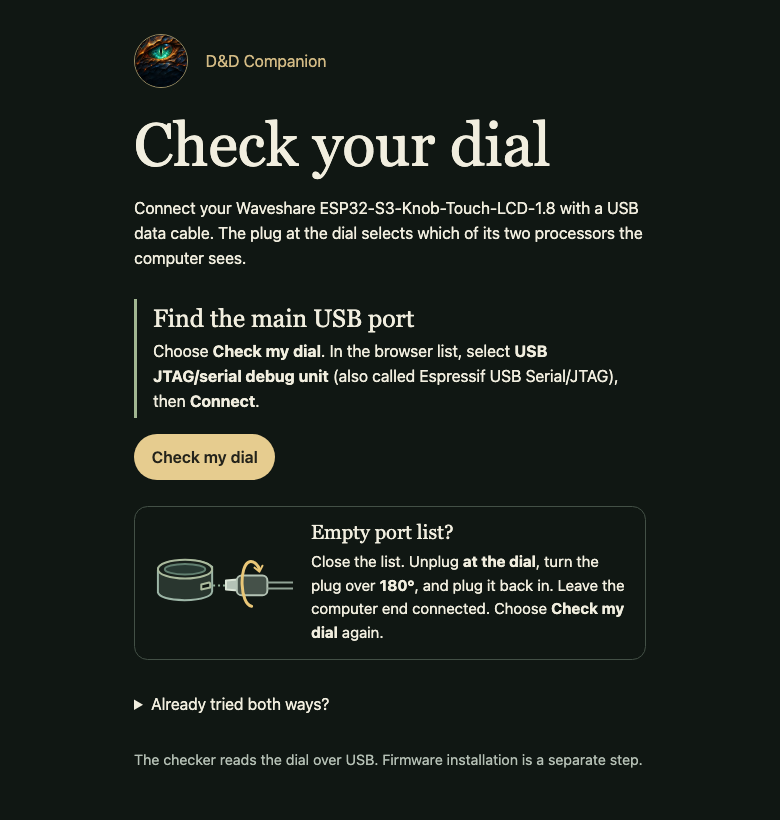

# Install, update or restore your dial

This guide is for the **Waveshare ESP32-S3-Knob-Touch-LCD-1.8**. Tap the top status arc and open **Firmware** to see your installed version. The distributed Companion 0.1.5 build ID is **`95a184a82`**.

| What the dial shows | Where to start |
| --- | --- |
| Companion 0.1.4, build `ccc889911` | [Update over your saved Wi-Fi](#update-over-wi-fi). This is the physically tested route to 0.1.5. |
| Companion 0.1.5 | [Add characters and Wi-Fi with your phone](MANUAL.md#set-up-at-the-table), or [open the player manual](MANUAL.md). |
| Development 0.1.3, build `1a8dc714d` | [Use the preserving USB update](#update-an-older-companion-over-usb), then update over Wi-Fi. |
| Factory demo | [Identify the main USB port](#check-the-usb-cable), then follow the [first installation on macOS](#first-installation-on-macos). |

## Update over Wi-Fi

1. Connect to the 2.4 GHz network saved in **Phone setup**. Keep the dial powered. Open **Firmware → Check now**.
2. Review the version and download size. Swipe right to decline or tap **Install update**. The dial verifies the download in its other application slot and restarts.
3. Open **Firmware** again. For the 0.1.4 to 0.1.5 update, look for **Installed v0.1.5** and **Build ID 95a184a82**. Open your characters to resume play.

## Restore the previous firmware

Open **Firmware → Previous firmware**. Read the version on the confirmation screen. Swipe right to cancel or tap **Restore now**. After the restart, open **Firmware** again. A dial updated from build `ccc889911` returns to that build. Characters, item counts and Wi-Fi use the saves already on the dial. The restore runs from the local copy.

| Find the previous firmware | Confirm the version |
| --- | --- |
|  |  |

The control appears after a compatible Wi-Fi update records a verified previous image. Opening **Check now** only checks for an offer. Starting another installation can reuse the other slot.

## Check the USB cable

Open **Check USB** in the player guide in desktop Chrome or Edge. Connect a data cable and choose **Check my dial**. If prompted, select **USB JTAG/serial debug unit**. If the port list is empty, unplug **at the dial**, turn that plug over 180° and reconnect. Keep the computer end in place. Close Arduino Serial Monitor if it has the port open.



A Companion reply confirms the orientation. For a factory demo choose **Restart and check processor**. Confirm **ESP32-S3 · 16 MiB flash** and the exact model on the board or packaging.

## Update an older Companion over USB

For development build `1a8dc714d`, the checker offers **One-time USB update**. Choose the [verified 0.1.4 bridge image](https://github.com/colombod/dnd-companion-firmware/releases/download/v0.1.5/usb-bridge-0.1.4.bin). Check for target build `ccc889911`, choose **Install 0.1.4**, and keep the cable connected until **USB update verified** appears. Compare the build ID on the dial. You can now follow the [Wi-Fi update steps](#update-over-wi-fi).


The browser offers this preserving install only for the identified starting build and partition layout. For another installed build, keep a verified recovery backup before planning a USB migration.

## First installation on macOS

The first installation replaces the factory firmware. The browser currently provides orientation checking on a factory dial. The source-build procedure below is for an experienced installer. A retail factory-to-0.1.5 installation still needs its own hardware qualification.

1. Install Arduino IDE 2 and **esp32 by Espressif Systems 4.0.0** in Boards Manager. Install Git and Python 3.10 or later. Check out the release tag and build the application and boot files together.

   ```sh
   git clone --branch v0.1.5 https://github.com/colombod/dnd-companion.git
   cd dnd-companion
   python3 -m venv .build/venv
   .build/venv/bin/python -m pip install -r tools/requirements-build.txt
   .build/venv/bin/python tools/build_picker.py --release-note 'Local first USB installation'
   ```

2. Set `DIAL_PORT` to the main serial port identified with the checker and `ESPTOOL` to the full path of the esptool executable installed by Boards Manager. Release the browser connection, verify the S3 and 16 MiB, then save the **entire factory flash** to a new private file. Wait for the verified SHA-256 and retain the backup on your computer.

   ```sh
   "$ESPTOOL" --chip esp32s3 --port "$DIAL_PORT" flash-id
   python3 tools/backup_dial.py --esptool "$ESPTOOL" --port "$DIAL_PORT" .local/recovery/factory.bin
   ```

3. With the verified backup saved, program the factory dial using the complete build's addresses. Reserve this procedure for a first install. Existing characters require a preserving update.

   ```sh
   (cd .build/objects && "$ESPTOOL" --chip esp32s3 --port "$DIAL_PORT" write-flash @flash_args)
   python3 tools/dial_console.py --port "$DIAL_PORT" STATUS LIST
   ```

4. Open **Phone setup** at the bottom of the picker and scan the QR code. [Add your Wi-Fi and character links](MANUAL.md#set-up-at-the-table). For a local build, compare the dial's build ID with the first nine characters of **ELF file SHA256** from `"$ESPTOOL" --chip esp32s3 image-info .build/bin/Companion.ino.bin`.

Wi-Fi installation needs a bootloader-confirmed running slot. A source install using the stock Arduino boot selector can report **Restore unavailable**. Keep the verified backup and use the USB maintenance route for that installation.

The downloadable OTA application is a single slot image. A first USB installation also needs the bootloader, partition map and boot selector from the build. [Tagged hardware and build notes](https://github.com/colombod/dnd-companion/blob/v0.1.5/docs/PICKER.md)
