# Player manual

[Install, update or restore your dial](INSTALL.md) · [What the dial can do](FEATURES.md) · [Gesture reference](#gesture-reference)

**Start at the character sheet.** Tap **Dice** at the lower edge of the portrait whenever you want a handful of dice. Swipe sideways or turn the ring to change the two shortcuts beside it. A right swipe on a detail screen takes you back one step.

| First pair | Second pair | Third pair | Fourth pair | Fifth pair |
| --- | --- | --- | --- | --- |
| **Checks** · **Saves** | **Spells** · **Actions** | **Magic** · **Rest** | **Health** · **Effects** | **Pack** · **Turn** |

Swipe **up** on the sheet to open Health from any pair. Jump to [Pack and Purse](#use-your-pack-and-purse), [Turn](#track-your-turn), [HP and death saves](#hit-points-death-saves-and-stabilization), [roll reminders](#received-roll-effects), [phone setup](#set-up-at-the-table), [the dice tray](#build-a-dice-pool), [casting](#cast-a-spell), or [the Forge Artificer](#playing-a-forge-artificer). To see what the engine handles for your character’s books, open [rulebooks and expansions](RULES.md#rulebooks-and-expansions).

The Forge, Health, Effects, Pack and Turn illustrations are Mac renders of the dial screens using example characters. Other play screens were captured on the dial. Phone illustrations show the English setup with example data. Your own sheet supplies the totals and available options.

## Gesture reference

**To reach your hit points:** start on the open character sheet, slide one finger upward across the glass, then lift. The portrait and name give you room to start a swipe. Tap the labeled **Dice** control to open the tray. If swiping is awkward, turn the ring until **Health / Effects** appears and tap **Health** on the left. Both routes open the same HP screen.

### From the character sheet

| Where you start | What to do | Where you land |
| --- | --- | --- |
| Character picker | Turn the ring or swipe left/right to browse. Tap the portrait to open the displayed character. | That character’s sheet |
| Open sheet | Swipe **up** for Health or **down** for the character picker. Start inside the screen, away from the rim, and keep contact until the end of the stroke. | Hit points or character selection |
| Open sheet | Swipe left for the next pair or right for the previous pair. Turning the ring also pages. Tap a side shortcut to open it. | Checks/Saves → Spells/Actions → Magic/Rest → Health/Effects → Pack/Turn |
| Open sheet | Tap the **Dice** control below the portrait’s center. | Mixed dice tray |
| Top status arc | Tap the Wi-Fi name or power indicator on the picker or sheet. Tap **Language** or **Firmware** for its controls. | Device status |
| Bottom arc | Tap **Phone setup** on the picker or **Refresh sheet** on an open sheet. | Setup QR or an online check for this character |
| Detail screen | Swipe right or tap the curved return caption. During a roll animation, wait for the result first. | The parent screen. On the character sheet, a right swipe pages the shortcuts instead. |

| Open Health | Make a mixed roll |
| --- | --- |
| 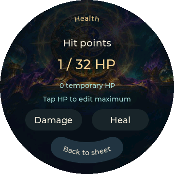 | 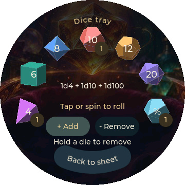 |
| Swipe up **from the sheet** to get here. Tap **Damage** or **Heal**, turn to set the amount, then confirm. This illustration is a firmware render. | Tap a rim die to add it. Hold the same die to remove one every half-second. Lift or slide off to stop. Spin the ring or tap the center to throw the pool. |

### During play

- **Checks and saves.** In Checks, swipe up/down or turn to browse skill groups and plain ability checks. Tap the named skill, ability or save. On a ready d20, swipe **up** for advantage, **down** for disadvantage, or tap the desired mode. Spin in either direction or tap the center to roll. Tap the result total to ready another roll. On an eligible result, tap the effect prompt and confirm the die to use. [Checks and saves](#roll-a-check-or-a-save)
- **Dice tray.** Tap **− Remove** to subtract with each tap and **+ Add** to resume adding. Spin speed changes the animation. On the result, swipe vertically to see more individual faces or tap the total to edit your pool. [Dice tray walkthrough](#build-a-dice-pool)
- **Spells and actions.** Swipe vertically or turn to browse entries and detail text. Tap the spell or weapon. On a cast preview, turn, swipe vertically or tap the pool chevrons to choose an eligible slot. Tap a Metamagic option to preview it and tap it again to clear it. **Cast** commits the displayed cost. On the resolution screen turn or tap the sides of the beam or dart count to choose a shot, then tap the roll you need. Spin on the ready roll. [Casting](#cast-a-spell) · [Weapon attacks](#use-your-equipment)
- **Health, death saves and effects.** Tap the HP counter to edit your maximum. In **Damage** or **Heal**, turn or tap the sides of the amount, then confirm. At 0 HP, open **Death save**, spin or tap to roll, then review and apply. Tap **Stabilize** when your table stabilizes you. In **Effects**, turn or swipe vertically to browse effects and their choices. [Health and stabilization](#hit-points-death-saves-and-stabilization) · [Received effects](#received-roll-effects)
- **Magic, rests and defenses.** Tap a conversion or rest to preview it. Where a selector is shown, turn, swipe vertically or tap its sides to change the choice. Confirm the spend or tap **Finish rest**. In **Actions → Defenses**, tap AC for equipment or temporary HP for its adjustment. Turn to set damage or elapsed time, then confirm. [Sorcery Points](#sorcery-points-and-metamagic) · [Rests](#short-and-long-rests) · [Defenses](#track-a-defensive-spell)
- **Pack and Turn.** Swipe vertically or turn to browse pack pages, select a recipient or adjust quantities. Tap the item or coin, check the preview, then confirm. **Undo** on the receipt reverses the recorded transaction. In **Turn**, tap a row to mark or correct an action, bonus action or reaction. Tap **Next turn** and confirm when your next turn begins. [Pack](#use-your-pack-and-purse) · [Turn](#track-your-turn)

### Setup, sheet review and firmware

On the dial, tap the setup QR to switch between the join-network code and the open-page code. Tap the bottom **Done** arc to exit. On the phone, choose the table network and tap **Connect dial**, or choose **Connect saved**. For artwork, drag the picture with one finger, adjust the Zoom slider and tap **Use crop**. [Phone setup](#set-up-at-the-table) · [Artwork](#profile-icon-and-alternate-background)

When a character has changed, tap **Apply update** to accept or **Keep current** to dismiss. For a firmware offer, tap **Install update** to proceed or swipe right to leave the preview. To return to a previous installation, tap **Previous firmware**, review the version and confirm with **Restore now**. [Character refresh](#refresh-and-play-offline) · [Firmware updates](#update-the-dial-over-wi-fi)

## Use your Pack and Purse

Swipe the sheet once to the **left or right** per pair, or turn the ring. From the first pair, one step backwards reaches **Pack / Turn**. Tap **Pack**. If your pack is missing items, refresh the sheet over Wi-Fi so the dial can read the character’s carried potions, scrolls and purse. They then work offline.

| Choose what to use | Give a potion to an ally |
| --- | --- |
| 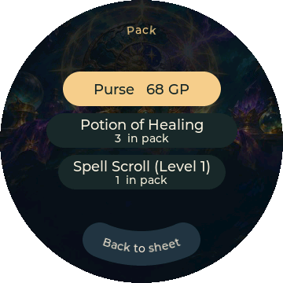 | 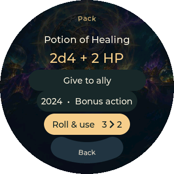 |
| Tap the actual stack. Swipe up or turn for additional stacks. | Tap **Use**, then tap the recipient or turn the ring. Tap the edition to change timing. **Roll & use** rolls once, spends the bottle and displays healing. |

**Drink** heals you, up to your confirmed maximum. **Give to ally** shows how much the other player should heal. If you are at 0 HP and an ally uses a bottle from your pack on you, select **Ally gives me mine**. You regain consciousness when healed and keep your own turn resources. If the bottle came from the ally’s pack, use **Health → Heal** instead. **Undo** on the receipt reverses the whole transaction, including HP and any tracked action.

| Pay for something | Read a scroll |
| --- | --- |
| 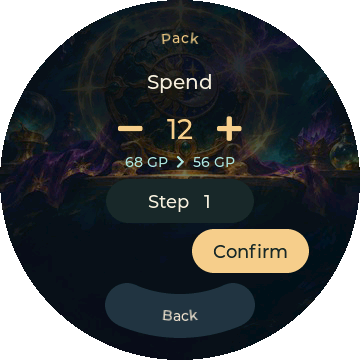 | 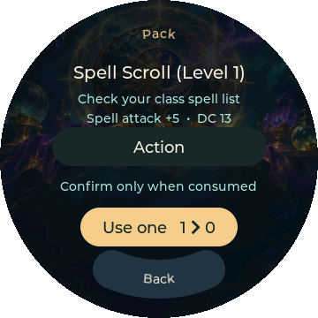 |
| **Purse → Spend** opens at one coin. Turn eleven steps for a 12 GP payment. Tap **Step** for increments of 10 or 100. Check the balance and confirm. | Identify the spell and its casting time at the table. Tap the timing, then **Use one** once the scroll is consumed. The dial shows a Beyond custom item name when supplied. A level-only entry leaves the written spell to the player. |

**Earn** records receipts and loot. Turn on the purse face to choose GP, SP, CP, EP or PP. Each denomination has its own balance. To hand over a gold piece and receive silver change, record the gold spent and the silver earned.

**Loot and refresh.** Tap an imported stack and **Adjust** to add or remove units. If you have no imported common healing potion, **Add healing potion** creates a separate local stack for bottles picked up at the table. New scrolls and other kinds of potion can be added on Beyond and imported by refreshing. If you later add the same local bottles to Beyond, reduce **Table healing potions** to zero to avoid counting them twice.

Each character can keep ten independently adjusted imported stacks plus the local potion stack and all five balances. Untouched stacks follow the accepted sheet. An edited stack or denomination keeps its local count until Beyond matches it or you choose **Use sheet** on the adjustment screen and confirm. Removing an imported stack on Beyond removes its dial entry after refresh. A changed source count also ends Undo for an earlier transaction on that stack or denomination. On-dial spending stays local.

## Track your turn

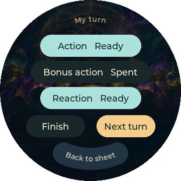

Tap **Turn → Start turn** when your turn begins. For example, cast *Eldritch Blast* as your action and roll each beam from the cast screen. The cast spends the action once. Drink a 2024 healing potion as your bonus action. Your reaction is still available for *Shield* if its trigger occurs. Mark **Next turn** at the start of your own next turn to recover all three. **Finish** ends tracking. A qualifying rest also ends tracking.

For a weapon attack, mark **Action** for the Attack action or **Reaction** for an opportunity attack. Roll the weapon normally from **Actions**. Imported actions with a recognized timing can also be marked from their detail screen while tracking. Tap a Turn row to correct it or to account for an extra action your rules grant. Checks and saves remain available at any time. The dial leaves movement, initiative order, triggers and exceptions to the table.

## Choose a language

Tap the top arc on the character picker or sheet, then **Language**. Tap **English**, **Italiano** or **Español**. The same selector appears at the top of phone setup. The choice applies to the whole dial, survives a restart and works offline. Imported character names, classes, spell names and rules descriptions keep the wording supplied by D&D Beyond. The language choice changes the controls and built-in check names. Dice, modifiers and saved characters use the same rules in every language.

## Which D&D Beyond characters work?

**Each character must be accessible by its individual link while signed out of D&D Beyond.** Paste the character sheet’s share link into phone setup. To check access, open the link in a private browser window. If you see a sign-in or permission prompt, the dial cannot refresh that sheet. A link to **My Characters** is an account page and cannot import a roster. The player chooses and shares each character separately. The dial never asks for D&D Beyond credentials.

## Set up at the table

1. Open **Phone setup** on the picker. Scan the QR code with your phone and join the dial’s network. If setup does not open automatically, scan the second QR after the phone joins.
2. In **Table Wi-Fi**, select a nearby 2.4 GHz network or enter a hidden network manually. **Show password** reveals what you type. Tap **Connect dial** to join and save a working connection, or **Save network** to store credentials for later. **Connect saved** reuses them. To delete one, tap **Forget** on its row, check the network name, then tap **Forget network**. **Cancel** keeps it.
3. In **Your characters**, paste one character link per line and tap **Add to dial**. Keep setup open to see the result. **Edit link** checks a replacement before changing the entry. **Remove** deletes the dial’s local entry. Your D&D Beyond sheet stays under your control.
4. Tap **Done** on the dial. Turn the wheel or swipe to browse, then tap a portrait. Swipe down on the character sheet to return to Characters.

| 1 · Start at the bottom rim | 2 · Open setup on your phone |
| --- | --- |
|  | 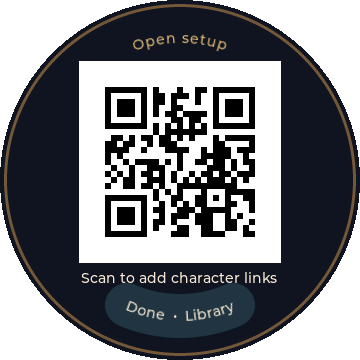 |
| Tap **Phone setup** and scan the join code on **your own dial**. | Once connected, scan the **second** code on that same dial if the page has not opened. |

| 3 · Connect the dial to table Wi-Fi | 4 · Add the character |
| --- | --- |
| 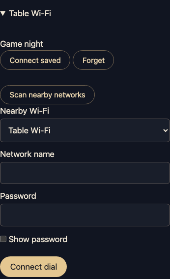 | 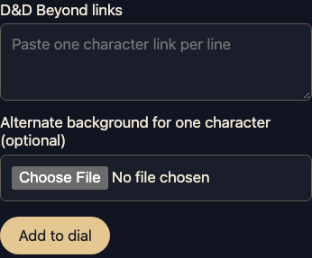 |
| Pick the network and tap **Connect dial**. Next time, use **Connect saved**. | Paste an individually accessible character link, tap **Add to dial**, and wait for the import result. |

## Profile icon and alternate background

The character’s D&D Beyond icon appears in a **128 × 128 circle at the center**. Phone setup prepares it from the character link. Keep the page open until the icon is saved. It then works offline. If the sheet has no usable icon, the dial shows that character’s initial in the circle.

Each character can have **one replaceable background**. In phone setup, choose **Upload background** beside the character, or attach a picture when adding a single link. Drag the picture and adjust **Zoom** in the round preview, then tap **Use crop**. The initial crop already fills the screen. **Cancel** keeps the current artwork. **Replace background** and **Remove background** affect only that character. A sheet refresh preserves your background.

| Artwork | What the dial stores |
| --- | --- |
| Profile icon from the link | 128 × 128 baseline JPEG, up to 12 KiB |
| Background from your phone | 360 × 360 baseline JPEG, up to 40 KiB |

**360 × 360 pixels** is the full resolution of the round screen. Keep faces and important details inside the circle. You can choose a larger photo (up to 16 MiB) on the phone to give yourself room to crop. The phone resizes the selection and sends only the finished JPEG. Replacing an image releases the previous file after the new one saves.

Under **Character picker**, choose **Background + icon**, **Icon only**, or **Background only**. This setting applies across the picker and survives a restart. Choose **Background only** to give a character’s alternative illustration the whole face. Characters without uploaded art use the dial’s illustrated background when a background is visible. The character sheet continues to show both layers.

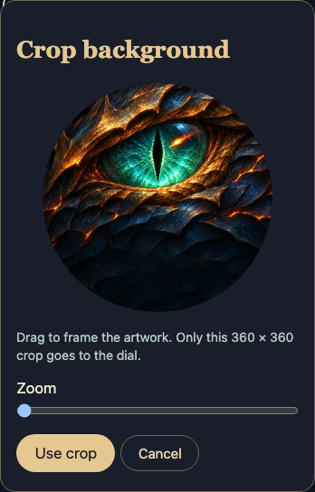

Drag the subject inside the circle before you tap **Use crop**. The phone discards pixels outside the saved 360 × 360 square. The glass hides the corners.

## Battery and Wi-Fi

The top arc shows the Wi-Fi symbol and connected network name, or **Offline**. A long name shortens to leave room for power and the picker position. Tap the arc to read the full name and supply voltage. The bottom arc opens **Phone setup** in the picker or **Refresh sheet** on the character sheet. Both arcs accept taps up to 48 pixels inward. On the picker, tap the portrait to open the sheet. On the sheet, tap **Dice** to open the tray. **USB** means a
USB host is connected. A high supply voltage without a host is shown as
**External**. On battery, the percentage is a voltage-based estimate. The S3
has no documented signal for actual charge current or completion, so the dial
shows **Charging status unavailable** while plugged in.

## Refresh and play offline

Tap **Refresh sheet** while connected. The dial checks an available HTTP version tag first and skips rapid repeat checks. Some D&D Beyond responses carry their revision inside the full sheet and require a download to compare. When a change is detected, review the old and new summaries and choose **Apply update** or **Keep current**, on the dial or phone. During a download the sheet shows the number of KiB received. An early interruption can retry once. If the check fails or you decline the update, the previously saved sheet stays available offline.

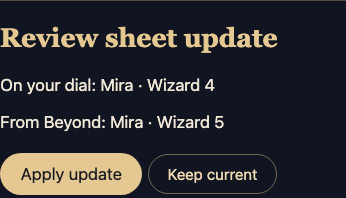

In this example, **Apply update** brings Mira’s fifth Wizard level onto the dial. **Keep current** leaves the fourth-level sheet ready to play.

The name curves above the portrait, with total level and proficiency on the next arc out. The lower arc shows each class with its own level. Below it, the sheet shows when it was cached or the outcome of your last refresh.

**Level** is the sum of the character’s class levels. **Proficiency** is the bonus added when a roll uses a proficiency. A level 6 character has a proficiency bonus of +3. [D&D 2024 basic rules](https://www.dndbeyond.com/sources/dnd/br-2024/playing-the-game)

## Roll a check or a save

Swipe sideways on the sheet or turn the ring to switch between five pairs of landmarks. On the first pair, tap **Checks** on the left of the portrait or **Saves** on the right. The six saving throws fit on one face. For a check, tap a named skill such as **History** or **Arcana**. Swipe vertically or turn the ring to browse three groups of six skills, followed by the six plain ability checks. Each shows your character’s modifier. An older cached character may need one online refresh to fill in these numbers.

Choose the circumstances by touch. Tap **Adv.**, **Normal** or **Disadv.**. You can also swipe up for advantage or down for disadvantage. Tap the large modifier or spin in either direction. Both dice appear when two were rolled, along with the kept face, modifier and total. Tap the total to ready another roll. A Constitution save with a concentration-specific benefit shows a reminder so you can choose advantage when appropriate. An unresolved modifier shows **Check your sheet**.

Swipe right to go back one screen, or tap the curved destination at six o’clock.

| Pick the roll | Read the result |
| --- | --- |
| 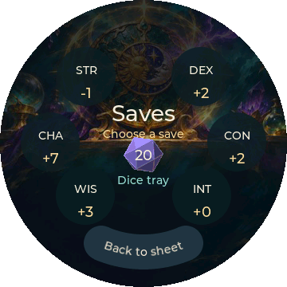 | 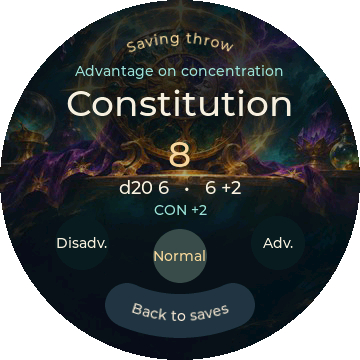 |
| Tap **CON +2**, choose the circumstances, then spin. | **6 + 2 = 8.** Compare 8 to the DC at the table. The concentration reminder helps you decide when advantage applies. |

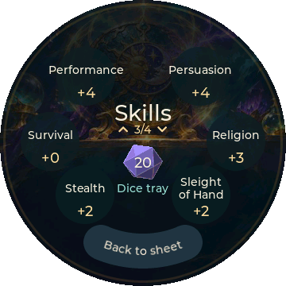

For **History** or **Arcana**, open **Checks** and browse the groups. Tap the **skill name** to use its training and modifiers. Tap a plain ability on the fourth page when the DM calls for an ability check without a named skill.

## Hit points, death saves and stabilization

Swipe **up** on the character sheet, or choose **Set maximum** in Defenses. On first use choose **Set maximum**, check the suggested number against the full HP maximum on D&D Beyond, turn the ring if needed, then confirm. If the import cannot resolve Constitution or a maximum, enter the maximum shown on the sheet. Refresh your sheet once after upgrading for the imported HP and death-save data. The preview subtracts the imported damage from your confirmed maximum. If you started offline with an old cache, use **Damage** or **Heal** to match the table. Later refreshes preserve local HP. Tap the HP number to edit the maximum after leveling. The fourth pair shows your HP on the lower sheet arc. At zero, that arc shows your condition on every pair.

Open **Damage**, enter the amount **after** reductions, and choose melee or other damage and normal or critical. Temporary HP absorb damage first. **Heal** restores ordinary HP up to the maximum. **Undo** on the receipt reverses the last transaction, including any change to temporary HP or death saves.

| A hit drops you to zero | Your turn starts |
| --- | --- |
| 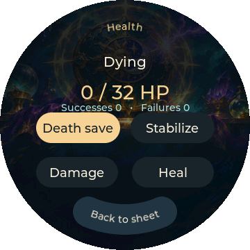 | 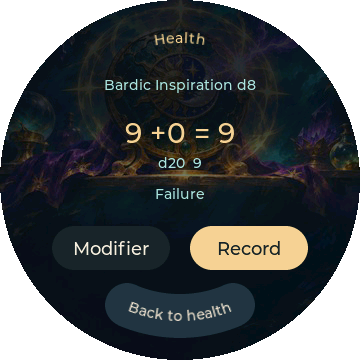 |
| Tap **Death save** if you are still dying. A fall from positive HP ordinarily starts with zero failures, even on a critical. Excess damage at least equal to your maximum kills outright. | Tap the mode if advantage or disadvantage applies, then spin or tap to roll. Tap an active effect at the top to use its die, or **Modifier** for other table bonuses. Tap **Record** once. |

A total of 10 succeeds. A **natural 1** gives two failures and a **natural 20** restores 1 HP regardless of modifiers. Three successes stabilize you. Three failures mean death. Further damage while already at 0 causes one failure, or two on a critical. Damage at least equal to your maximum at 0 causes instant death. Follow a feature that changes the outcome, such as Death Ward, at the table before recording the hit.

| An ally casts *Spare the Dying* | An ally then restores 1 HP |
| --- | --- |
| 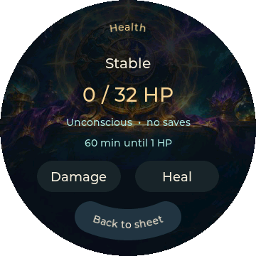 |  |
| After the spell resolves on you, tap **Stabilize**. Use the same control after successful first aid. It clears both counters, leaves you unconscious at 0 and stops the saves. | Tap **Heal**, enter the HP actually restored and confirm. You regain consciousness. Temporary HP alone leave you at 0. |

On stabilization the dial rolls **1d4 game hours** until natural recovery of 1 HP. Advance the clock in **Actions → Defenses → Pass time**. Damage before recovery breaks stability, cancels the timer and counts the failure for being hit at 0. A character first imported already stable has an unknown start time. Record **Heal → 1** when the table says that recovery is due. A dead character needs an actual revival effect. **Revival → Return at 1 HP** records that result. For a revival that gives more HP, enter the remainder with **Heal**.

## Received roll effects

Open the fourth sheet pair and tap **Effects**. Turn the ring to the effect, tap **Set**, choose the version, skill or die supplied by the caster, then tap **Received**. Do this when the effect reaches your character. Knowing the spell, or having ordinary Inspiration checked on the sheet, does not grant a received die.

| Register what you received | Use it on the result |
| --- | --- |
| 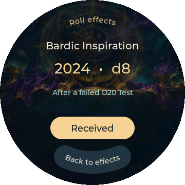 | 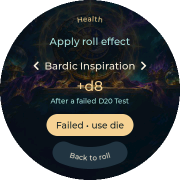 |
| Here a bard gave you a **2024 d8**. Choose the giving bard’s die. | Tap the reminder above an eligible result. If several effects apply, turn the ring to one. The dial rolls the die, adjusts the result and spends a one-use effect. On a death save, finish by tapping **Record**. |

| Received effect | When the reminder appears | What happens when you use it |
| --- | --- | --- |
| **Guidance, 2014** | One ability check, including a plain ability check | Add 1d4. The effect ends on use. |
| **Guidance, 2024** | Only checks using the skill chosen when cast | Add 1d4 on each qualifying roll while the spell lasts. Selecting Arcana leaves History unchanged. |
| **Bardic Inspiration** | An ability check, attack or save, including a death save | Add the giving bard’s d6, d8, d10 or d12 once. For 2014, decide before the DM announces the outcome, within 10 minutes. For 2024, use it after a failure, within one hour. |
| **Bless / Bane** | An attack or saving throw, including a death save | Add or subtract 1d4 on each qualifying roll during the spell. Neither changes an ordinary skill check. |

The dial allows each effect once per roll. Apply each qualifying die before settling the outcome. A natural 1 or 20 on a death save keeps its special outcome. **Pass time** advances the durations in game time. Use **Clear** immediately if the caster loses concentration or the effect ends early. Heroic Inspiration is a separate reroll and remains table-managed.

## Build a dice pool

Tap **Dice** on any page of the character sheet, or tap the central **Dice tray** die on a check or save selector. All seven sizes are on one face. To build **3d6 + 1d8**, tap d6 three times and d8 once. The badges and center formula update as you touch.

- **Tap** adds one of that die in Add mode.
- **Hold** removes one at 0.5 seconds and one every 0.5 seconds while you stay on the same die. Each removal gives a short pulse. Lift or slide off to stop. At zero, the pulse stops and releasing leaves the count at zero.
- **− Remove** makes quick taps subtract one. Tap **+ Add** to resume adding.
- **Tap the center or spin** to roll the whole pool once. Every throw animates a numbered d20. A faster spin turns the d20 faster and a little longer. Direction follows the ring. The selected dice determine the result. Tap the result total to edit, or swipe vertically through groups of six individual faces.

The tray holds up to 100 dice. Each character remembers their last **rolled** mix across restarts.

| Build the pool | Spin once and read every die |
| --- | --- |
|  | 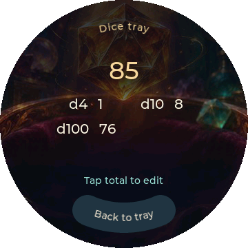 |
| Tap **d4**, **d10** and **d100** once each. If you add an extra, hold that die for half a second to remove one. | **1 + 8 + 76 = 85.** Tap **85** to take the same pool back into the tray and edit it. |

## Look up spells and actions

Swipe sideways on the character sheet for **Spells** and **Actions**. Wheel turns also switch the pair. Tap a landmark, swipe vertically through groups of three, and tap a name to read its details. On detail pages, swipe vertically to read more, then swipe right to return to the same group.

At the top of the spellbook, **Spell** and **Pact** show slots left out of the total. **Pact 1/2** means one is ready and one is used. For pools of five or fewer, each filled dot is a ready slot and each hollow dot is spent. A temporary slot created with Sorcery Points counts toward the total until you spend it or finish a long rest. Open a spell to see the pools that can cast it, including higher-level slots. A cantrip shows **No slot needed**.

| Browse the book | Open a spell |
| --- | --- |
| 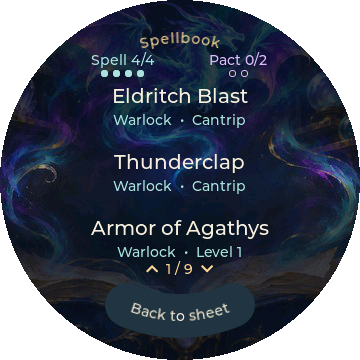 | 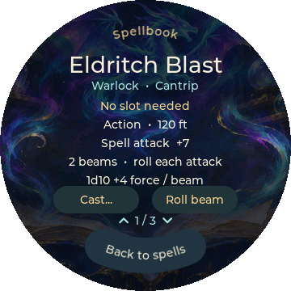 |
| Turn the ring to browse. This character has spent both Pact slots. | Tap **Eldritch Blast**. This character can still cast the cantrip and roll an attack for each of its two beams. |

The spellbook keeps separate grants of the same spell. It shows casting time, range, concentration, spell attack or save DC when available, and the imported effect. Actions include listed class, species and feat actions and equipped weapons.

### Use your equipment

| Find the weapon | Choose what to roll |
| --- | --- |
| 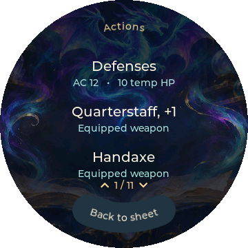 | 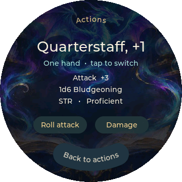 |
| Open **Actions**, then the equipped item. | Tap **Roll attack** first. On a hit, tap **Damage**. This quarterstaff uses the character’s ordinary proficient Strength attack at **+3**. |

Open **Actions**. **Defenses** shows your current AC and temporary HP. Equipped weapons follow it, ahead of class and species actions. Open a weapon and tap **Roll attack** or **Damage**. A versatile weapon can switch between one and two hands when a shield is not equipped. Change your equipment on D&D Beyond and refresh the character on the dial.

Open **Actions → your weapon** to see its attack bonus, damage die and ability. A character with Pact Weapon enabled on their linked sheet gets a **Bonded weapon** label on the one marked weapon. If Beyond sends conflicting marks, open the equipped weapon you use and tap **Choose bond → Bond weapon**. You can move that choice to another marked weapon. A Hex Weapon uses its own feature and weapon selection.

The dial checks saved choices against the accepted sheet, including offline. Removing the enabling feature, the mark or the equipped item clears a conflicting saved choice. An older cache with an inseparable pact bonus asks for a sheet refresh before that weapon can roll. Review an online profile change before applying it.

Tap the AC number under **Defenses** to see your equipment. If your character has **Armor of Shadows** and wears no body armor, tap **Mage Armor** here. The preview shows your current and warded AC. Tap **Cast** to start eight game hours, or swipe back to cancel. With Dexterity 14 and no armor or shield, your AC goes from 12 to 15. The dial calculates both values even when your sheet has no manual bonus.

The optional **Sheet +N** control is for an independent miscellaneous AC adjustment from D&D Beyond. It starts off. If the sheet bonus represents Mage Armor, casting the spell on the dial is the only step needed.

### Track a defensive spell

| Read the equipment AC | Preview the spell |
| --- | --- |
| 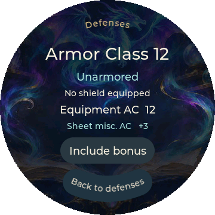 | 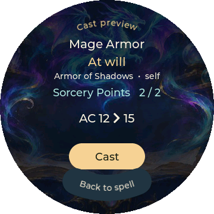 |
| Here the sheet has a manual **+3**. Leave it out if it represents the spell you are about to cast. | Tap **Cast** for Armor of Shadows. This character reaches **AC 15** without spending a slot or counting the +3 twice. |

- **Mage Armor** on yourself sets the unarmored base to 13 + DEX for eight game hours. Worn body armor prevents it. The Armor of Shadows grant targets yourself and costs no slot. A regular grant can target an ally and spends its displayed slot. A qualifying equipped shield can still contribute AC.
- **Armor of Agathys (2024)** grants 5 temporary HP per slot level. If you already have temporary HP when a casting offers a new pool, tap **Keep** for the current pool or **Take** for the spell’s pool, then **Cast**. The slot is spent on confirmation. The pools never add together.
- Each Agathys casting lasts one game hour while you have temporary HP. During an overlap the stronger casting supplies the cold damage. An equal-level recast renews that level. A weaker recast is tracked for its own hour: the dial preserves your current temporary HP during the overlap and applies the weaker cold damage if its timer outlasts the stronger one. Running out of temporary HP ends every active Agathys casting. Wearing armor or casting Mage Armor leaves Agathys active.
- In **Defenses → Take hit**, select **Melee hit** or **Other**, enter damage after reductions, and confirm. The melee hit that removes the last temporary HP still triggers cold damage. The receipt shows what the attacker takes. Overflow automatically reduces ordinary HP after you have set your maximum in Health. Tap the temporary HP on the defense face to record a replacement pool. Temporary HP alone never activate Agathys.
- The **Shield** reaction spell adds 5 AC until your next turn. Use **Pass time** for your next turn or a longer interval in the story. It advances spell durations in game time. Short and long rests also advance or clear tracked defenses. Remaining 2024 temporary HP can outlast the one-hour Agathys retaliation and expire on a long rest.

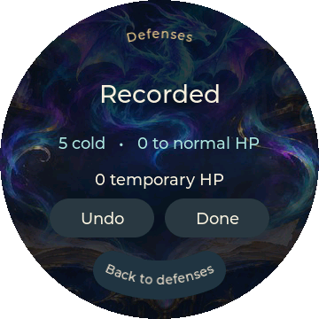

This hit consumed the last temporary HP. The eligible melee attacker still takes **5 cold**, and **0** carries through to ordinary HP. Tap **Undo** here if you recorded the wrong hit.

### Cast a spell

Tap **Cast...**. Turn the ring, swipe vertically, or tap the chevrons beside the pool name to choose an eligible regular or Pact slot. The preview shows how many slots of that level are left and how many are used. Cantrips and supported at-will spells show **At will**. A restricted or limited-use grant can require checking your sheet. Tap **Cast** to spend the displayed cost.

The resolution screen shows a spell attack, target save, or automatic hit. Tap **Roll attack** or **Roll dice**, then tap the center or spin. A right swipe returns to the same cast. Tap the sides of a beam or dart count to select the next one. Each attack has its own roll. A critical doubles the damage dice and adds the flat modifier once. Toggle critical damage after confirming a critical hit. For multiple effects, touch either side of the effect line. Save-based spells with recognized half-damage text also show the halved total. Slot spending happens once, at confirmation. **Undo cast** returns the resources spent.

Eldritch Blast uses total character level for the beam count and applies the imported Agonizing Blast modifier per hit. Magic Missile uses the confirmed slot level for the dart count and deals 1d4 + 1 per dart. Tables that share one damage roll across the darts can reuse the displayed result. Healing dice marked with the casting stat include that character’s modifier. The spell description remains available for secondary effects, target eligibility and table rulings.

### Sorcery Points and Metamagic

Open **Magic** on the third sheet page. **Slot to points** previews the balance before you spend a regular or Pact slot. At Sorcerer level 2, converting a level-2 slot at 0/2 restores both points. At 1/2 it restores one. At 2/2 the dial keeps your slot. **Points to slot** shows the cost of creating one ordinary slot. Created slots can take you above your usual slot count and expire on a long rest. The dial uses your Sorcerer class level and edition for eligibility. **Metamagic** spends points on your learned options.

On **Cast preview**, tap **Distant** to see the new range or **Twinned** to see the effective spell level and extra target. Each appears when your character knows the option and the spell qualifies. Twinned uses the 2024 rule for spells that gain a target when upcast. With 2 points available, selecting either shows **2 › 1 left**. Tap the same choice to clear it, tap the other to switch, or swipe right to leave. Only **Cast** spends the point and any selected slot together. At zero points you can still cast normally if you have the required slot. Other supported Metamagic costs are available under **Magic**. [2024 Sorcerer rules](https://www.dndbeyond.com/sources/dnd/br-2024/character-classes#MetamagicOptions)

| Before choosing Metamagic | After tapping Twinned |
| --- | --- |
| 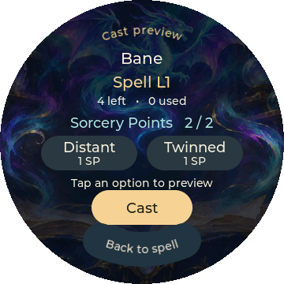 | 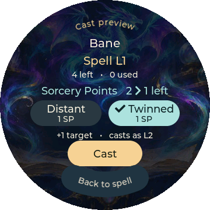 |
| Here **Bane** can use either learned option. | You still spend a **level 1 slot**. Twinned raises the spell’s effective level for the extra target. Tap **Cast** to spend the slot and one point. |

### Short and long rests

Open **Rest**, choose **Short rest** or **Long rest**, read the before-and-after counts, then tap **Finish rest**. A short rest restores Pact slots. An eligible 2024 Sorcerer can choose Sorcerous Restoration once per long rest, while a 2014 level 20 Sorcerer regains four spent points. A long rest restores regular and Pact slots and Sorcery Points, removes temporary created slots and readies Restoration. For a Forge Artificer, the rest preview includes any Flash of Genius or Mapping Magic uses the rest will restore. A qualifying long rest refills ordinary HP once you have confirmed your maximum. Record Hit Dice expenditure on the sheet and apply short-rest healing in Health.

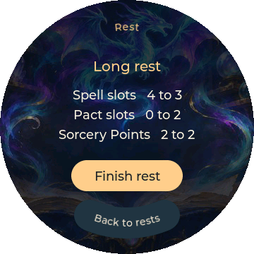

Here a temporary created slot expires, so **Spell slots 4 to 3** is expected. Both Pact slots return. Read the counts before tapping **Finish rest**.

Each character keeps local spending in flash. Switching characters, rebooting and refreshing a profile preserve recorded play. A fresh session starts with the source sheet’s spent counts. Use **Undo** on the receipt or **Undo** in the Rest menu to reverse the most recent stored change. Play changes stay on the dial.

## Update the dial over Wi-Fi

On the picker or sheet, tap the **top status arc → Firmware**. **Installed** and **Build ID** identify the software on your dial. Tap **Check now** on Wi-Fi to see an offer. Read the changes, then tap **Install update** or swipe right to decline. Keep the dial powered through its restart.

After a compatible Wi-Fi update, **Previous firmware** shows the version you can return to. Tap **Restore now** to confirm. Your current characters, play state and saved networks stay on the dial.

| Review the Wi-Fi offer | Review the restore target |
| --- | --- |
| 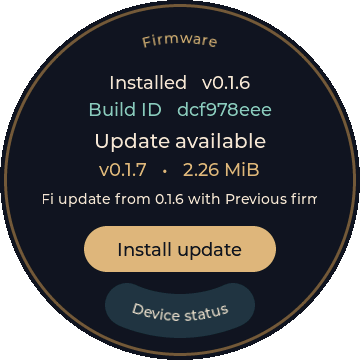 | 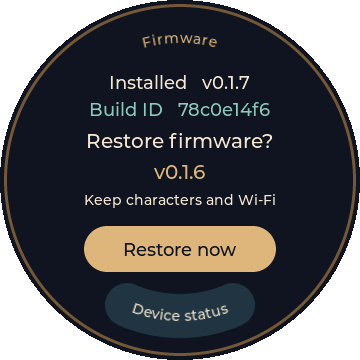 |

For first installation or a **USB update required** message, find your starting version in the [installation guide](INSTALL.md). It identifies the correct file and shows how to check the cable orientation.

## Playing a Forge Artificer

Open **Refresh sheet** and accept the update if your dial is missing a feature you gained on D&D Beyond. Once your Forge Artificer has Flash of Genius, you can use it on your own roll or help another creature. For a failed check or save, tap **Failed? Use reaction** if you want to spend Flash of Genius. The dial keeps the die and adds your bonus. For someone else's failed roll, open **Actions → Flash of Genius**. Confirm that you can see the creature within range and have your Reaction available.

A Cartographer can have two entries for *Faerie Fire*. Choose **Cartographer Spells** to spend a spell slot or **Mapping Magic** to spend a feature use. The cast preview shows the cost. **Rest** restores the appropriate uses and offers Undo. [Supported features and sheet-managed effects](RULES.md#published-supplements-and-class-versions)

| Spend a slot | Keep the slot and spend a use |
| --- | --- |
| 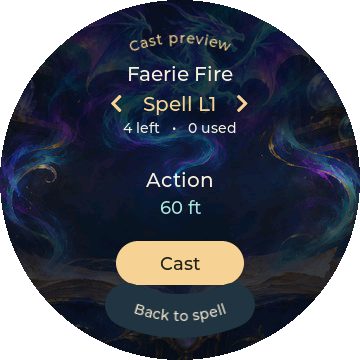 | 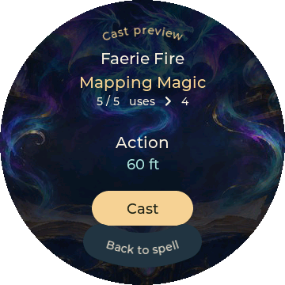 |
| **Spell L1** is the ordinary slot. Turn the ring here to see other eligible slots. | **Mapping Magic** names the feature paying for this casting. Tap **Cast** to confirm. |

| Another creature failed a check or save | After using the reaction |
| --- | --- |
| 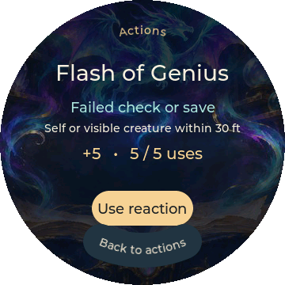 | 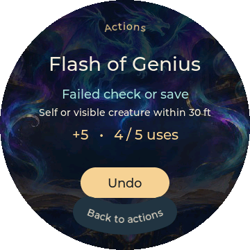 |
| Confirm a visible creature within 30 feet and an available Reaction. Tap **Use reaction**. | Tell the player to add **5** to their result. The dial records **4/5** uses. Tap **Undo** to restore the use if needed. |
