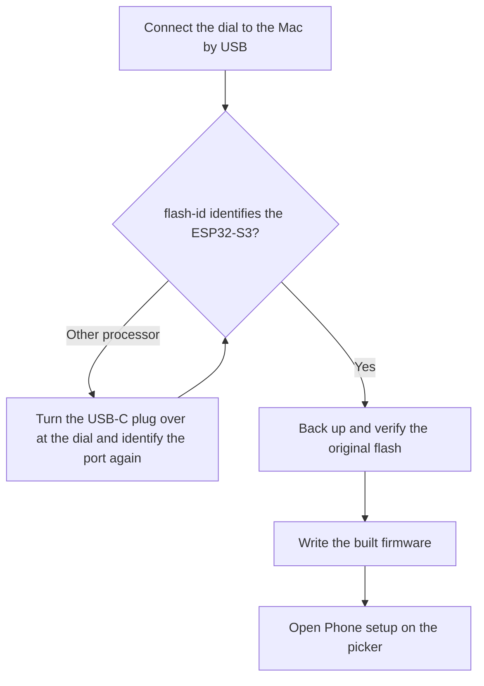
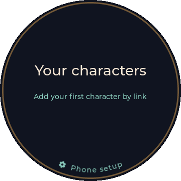

# Character picker on macOS

The dial imports individual characters accessible by link while signed out.
For player setup and privacy settings, see the [player manual](MANUAL.md).

Use the main ESP32-S3 USB connection. On this Waveshare the orientation of the USB-C plug **at the dial** selects the processor. The S3 enumerates as Espressif USB Serial/JTAG. Identify it with `esptool --chip esp32s3 --port PORT flash-id`. This board has 16 MiB flash and 8 MiB OPI PSRAM.

## Build



Install Arduino IDE 2 and install **esp32 by Espressif Systems 4.0.0** in Boards Manager. Use Python 3.10 or later. From a fresh checkout on macOS:

```sh
git clone --branch v0.1.5 https://github.com/colombod/dnd-companion.git
cd dnd-companion
python3 -m venv .build/venv
.build/venv/bin/python -m pip install -r tools/requirements-build.txt
.build/venv/bin/python tools/check_device_art.py
.build/venv/bin/python tools/build_picker.py
```

The firmware image is `.build/bin/Companion.ino.bin`. The four round illustrations in `docs/screens/art/` and the seven-die atlas in `docs/screens/dice-tokens.png` are build inputs. The build generates the numbered d20 animation from `tools/spin_art.py`, the localized screen text and phone pages from `locales/` and `firmware/phone/`, and accent glyphs from the Montserrat font in the pinned Waveshare archive. The images in `docs/screens/guide/` illustrate the manual and use no flash on the dial.

The first build downloads and verifies the pinned drivers and libraries. It uses LVGL 8.4.0, SensorLib 0.3.1, ArduinoJson 7.4.2 and the Arduino CLI included in the IDE. A new device starts with an empty library. Add accessible character links, profile icons and personal backgrounds through **Phone setup**. To preload your own character summaries, optionally run `.build/venv/bin/python tools/seed_picker.py 'https://www.dndbeyond.com/characters/YOUR_ID'` before building. Private seeds and recovery images live in the ignored `.local/` directory.

For the first upload, use the Espressif esptool shipped with the installed core. Save the original flash under a new private filename and verify it before writing. Substitute the confirmed S3 port and the absolute esptool path on your Mac.

```sh
python3 tools/backup_dial.py --esptool "$ESPTOOL" --port "$DIAL_PORT" .local/recovery/original.bin
(cd .build/objects && "$ESPTOOL" --chip esp32s3 --port "$DIAL_PORT" write-flash @flash_args)
python3 tools/dial_console.py --port "$DIAL_PORT" STATUS LIST
```

## Play



On a fresh dial, tap **Phone setup** on the lower rim to add the first character. Follow the [phone and dial pictures in the manual](MANUAL.md#set-up-at-the-table).

- **Choose a character.** Turn the ring or swipe sideways to browse. Tap the portrait to open. Swipe down on the sheet to return. Swipe sideways to switch control pairs. Tap the sheet portrait to roll dice. A committed selection gives a short pulse. Opening a linked character makes it the active sheet across restarts.
- **Pair a phone.** Tap the curved **Phone setup** label along the lower rim on the picker. Scan the QR code with the phone camera and join the dial. The phone may open the setup page automatically. Once the phone joins, the QR changes to a link to the page. Scan that code if needed. Tapping the code switches between the two. Tap **Done** to close setup. Pairing also expires after ten minutes.
- **Connect table Wi-Fi and add links.** Scan and select a 2.4 GHz network on the phone. Under **Your characters**, paste one D&D Beyond link per line. The dial queues links and fetches them when online. Successful imports survive restarts. Unfinished import requests are kept in RAM. The library holds 12 linked characters. The player manual covers editing, removal, custom images and saved networks. In **Character picker**, select **Background + icon**, **Icon only**, or **Background only**.
- **Refresh.** Open a linked character and tap **Refresh sheet**. The S3 validates HTTPS and fetches directly from the unofficial D&D Beyond character service. It checks the returned character ID, name and class levels before offering a changed summary for review. Browsing another character during the download is supported. Failed requests leave the cached entry available. The download includes the summary, checks and saves, spellbook and actions. A 360 × 360 phone crop supplies the optional background. Phone setup also caches the separate 128 × 128 linked icon.
- **Diagnostics.** The USB console supports `STATUS`, `LIST`, `PICK`, `OPEN <numeric-id>`, `REFRESH` and `HAPTIC`. Status reports panel transfers, touch samples, wheel detents and haptic commands. Use finger input to verify mapping, look at the full circle and feel the pulse. The console's `--watch 30` option observes the actual touch and wheel events.

## Verify the importer on the Mac

```sh
clang++ -std=c++17 -I.build/libraries/ArduinoJson/src tools/check_sheet.cpp -o .build/check_sheet
.build/check_sheet
```

The check uses the firmware parser. It also accepts a private downloaded service response and expected numeric character ID as arguments.

The portable math tests and Lean proofs are described in [Rules](RULES.md).
