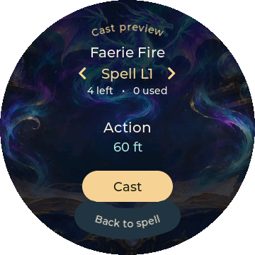

<!-- player-guide:start -->
# Which D&D rules does my dial use?

## Rulebooks and expansions in firmware 0.1.5

Tap the **top status arc → Firmware** to see your installed version. The Forge Artificer counters first appear in **0.1.1**. After installing it, open the character and choose **Refresh sheet**, then accept the update to import its feature grants. The dial reads the versions of the class, spell and granting feature on each accepted D&D Beyond sheet. There is no edition switch to set for the whole library.

| Book on your sheet | What the dial handles | What you handle at the table |
| --- | --- | --- |
| **Player’s Handbook (2014)** and corresponding Basic Rules | Six ability checks, 18 skills, six saves, proficiency, advantage and disadvantage. HP, death saves and stabilization. Imported weapon attacks, supported armor and shields, regular and Pact slots, Font of Magic, Metamagic costs and legacy Sorcerous Restoration. | Apply situational effects and adjudicate targets. Legacy Twinned Spell has a point cost in **Magic**. You decide whether the spell qualifies. The dedicated Armor of Agathys ward requires the revised spell. [2014 PHB](https://www.dndbeyond.com/sources/dnd/phb-2014) |
| **Player’s Handbook (2024)** and Free Rules | The same core rolls, HP, death saves and gear. Revised Sorcerer slot creation, Sorcerous Restoration, eligible Twinned casts, and the Agathys ward. The Warlock’s imported grants can enable Pact Magic, Pact Weapon, Armor of Shadows and Agonizing Blast. | Track Hit Dice, initiative order, conditions and general Concentration on your sheet. Many classes use the common roll and casting features without dedicated class-resource counters. [2024 PHB](https://www.dndbeyond.com/sources/dnd/phb-2024) |
| **Xanathar’s Guide to Everything** | For the legacy Hexblade, Hex Warrior’s designated weapon can use the granted attack ability when the sheet enables Hex Weapon, marks the equipped item, and the character is proficient with it. The Two-Handed property disqualifies this selection. | Track Hexblade’s Curse and other subclass effects. Hex Weapon and Pact Weapon are separate grants. An old weapon mark alone grants neither bonus. [Xanathar’s](https://www.dndbeyond.com/sources/dnd/xgte) |
| **Tasha’s Cauldron of Everything** | Legacy Artificer spells and slots use sheet data. For a Sorcerer who learned them, **Magic** can spend the cost of Seeking Spell or Transmuted Spell. | Resolve the reroll or change of damage type yourself. Manage legacy Infuse Item, item charges and specialist abilities on the sheet. [Tasha’s](https://www.dndbeyond.com/sources/dnd/tcoe) |
| **Eberron: Rising from the Last War** | The legacy Artificer uses the common class slot table, casting ability, and imported spell and action entries. | Track legacy Flash of Genius uses, infusions and specialist resources. A legacy Artificer does not receive the revised class’s recovery rules. [Rising from the Last War](https://www.dndbeyond.com/sources/dnd/erftlw) |
| **Eberron: Forge of the Artificer** | The revised Artificer has multiclass slot rounding, Flash of Genius spending and recovery, and Cartographer’s two ways to cast *Faerie Fire*. Guided Precision supplies reminders. The feature table below gives the level and rest conditions. | Track replicated items, stored spells, map placement, companions and Guided Precision’s turn and target. Alchemist, Armorer, Artillerist and Battle Smith can use eligible base-class features. Their specialist mechanics have no dedicated counters. [Forge of the Artificer](https://www.dndbeyond.com/sources/dnd/efota) |
| **Arcana Unleashed** | A Vestige Patron Warlock sheet imports through the ordinary checks, spells, actions and equipment paths. Recognized dice and modifiers work on those entries. | Run the vestige and patron-specific effects from the sheet. The patron name alone grants no Pact Weapon benefit on the dial. [Arcana Unleashed](https://www.dndbeyond.com/sources/dnd/au) |

**Other sources.** The importer accepts recognized entries regardless of the source book. A feat, magic item or homebrew action may therefore appear and have rollable dice. Its presence establishes only the displayed roll or cost. Unresolved entries can say **Check your sheet**. The Dungeon Master’s Guide, Monster Manual, other settings, playtest material and third-party books have no separately verified book-wide support here. The firmware has no D&D 3.5, Pathfinder, Call of Cthulhu or Daggerheart rules profile.

**Reading a mixed-edition sheet.** A character can have a revised Sorcerer class and a legacy spell. The class determines Sorcery Point costs and recovery. The spell’s own record determines which spell-specific effect the dial can run. For example, choosing the legacy *Armor of Agathys* leaves its temporary HP and retaliation to the player, even on a revised character. The common roll and casting rules are drawn from the [2014 Basic Rules](https://www.dndbeyond.com/sources/dnd/basic-rules-2014) and [2024 Free Rules](https://www.dndbeyond.com/sources/dnd/br-2024).

<!-- player-guide:end -->

### Inventory and turn timing in 0.1.3

| At the table | What the engine records |
| --- | --- |
| Drink or administer a healing potion | Match the imported standard potion and healing dice. Common, greater, superior and supreme heal 2d4+2, 4d4+4, 8d4+8 and 10d4+20. The actor spends an action in 2014 or a bonus action in 2024. The preview starts with the character’s starting-class edition and lets the player select the table’s rule. An ally can administer your carried potion while you are unconscious. Healing applies the existing HP maximum, death-save and revival rules. [2014 equipment](https://www.dndbeyond.com/sources/dnd/basic-rules-2014/equipment#AdventuringGear) · [2024 potion activation](https://www.dndbeyond.com/sources/dnd/br-2024/magic-items#Potions) · [Healing by potency](https://www.dndbeyond.com/sources/dnd/br-2024/magic-items-a-z#PotionofHealing) |
| Read a scroll | The player resolves the item, checks eligibility and selects its casting time. The published 2024 equipment entries for a cantrip and level 1 show attack +5 and save DC 13 when applicable. For a standard Spell Scroll above your normal casting level, check the item’s rule for a spellcasting ability check against DC 10 + spell level. A failed required check consumes the scroll. An interrupted casting preserves it. Confirming consumption removes one scroll and spends no spell slot. Other scrolls and homebrew effects use their own descriptions. [2024 equipment scrolls](https://www.dndbeyond.com/sources/dnd/br-2024/equipment#SpellScroll) · [2024 Spell Scroll](https://www.dndbeyond.com/magic-items/9229085-spell-scroll) · [2014 magic items](https://www.dndbeyond.com/sources/dnd/basic-rules-2014/magic-items#SpellScroll) |
| Start your next turn | Reopen the action, bonus action and reaction, including a reaction used during another creature’s turn. End Shield at the start of the turn. The player chooses when the turn begins. Checks, saves, damage rolls and individual attacks leave the trackers alone. Mark the Attack action once for Extra Attack, or mark Reaction for an opportunity attack. [2014 combat](https://www.dndbeyond.com/sources/dnd/basic-rules-2014/combat#YourTurn) · [2024 combat](https://www.dndbeyond.com/sources/dnd/br-2024/playing-the-game#Combat) |
| Cast or activate a feature | While tracking, a confirmed spell with a recognized casting time spends its action, bonus action or reaction together with its other costs. Flash of Genius spends a reaction. Creating a spell slot costs a bonus action. Turning a slot into points costs a bonus action in 2014 and is free of action cost in 2024. The table handles triggers, extra actions, restrictions on spells cast in the same turn and longer casting times. [2014 Sorcerer](https://www.dndbeyond.com/sources/dnd/basic-rules-2014/classes#Sorcerer) · [2024 Sorcerer](https://www.dndbeyond.com/sources/dnd/br-2024/character-classes#Sorcerer) |

Spend and earn in the selected denomination. The player makes change explicitly. Accepted sheet updates preserve local counts until they match the sheet or the player chooses **Use sheet**. Rests preserve inventory. [Illustrated Pack and Turn guide](MANUAL.md#use-your-pack-and-purse) · [Inventory and persistence regressions](../tools/check_pack.cpp)

Run the standalone inventory checks on macOS after preparing the build libraries.

```sh
clang++ -std=c++17 -Itools/test_support -I.build/libraries/ArduinoJson/src tools/check_pack.cpp firmware/Companion/session_store.cpp -o .build/check_pack
.build/check_pack
```

### Life and received effects in 0.1.2

Both core editions use the character’s confirmed maximum, temporary HP, ordinary HP, death-save counters and stability. The session engine handles instant death, critical damage at zero, natural 1 and 20, healing, stabilization by an ally and timed recovery after 1d4 hours. A qualifying long rest refills HP. The revised starting class requires at least 1 HP to start a short rest. Use **Pass time** to advance an unconscious character’s recovery without claiming rest benefits. The DM resolves exceptions such as Death Ward, knockout choices and the conditions of a revival spell. [2014 damage and healing](https://www.dndbeyond.com/sources/dnd/basic-rules-2014/combat#DamageandHealing) · [2024 damage and healing](https://www.dndbeyond.com/sources/dnd/br-2024/playing-the-game#DamageandHealing) · [2024 rest rules](https://www.dndbeyond.com/sources/dnd/br-2024/rules-glossary#ShortRest) · [2024 spell descriptions](https://www.dndbeyond.com/sources/dnd/br-2024/spell-descriptions#SparetheDying)

Received Guidance, Bardic Inspiration, Bless and Bane prompt on eligible results. The player supplies the version of the received effect, the giving bard’s die or the selected skill, and confirms timing and concentration. These effects persist with the character. One-use dice are spent when rolled. The normal HP baseline is a player-confirmed value because Beyond provides build components and may include conditional benefits. Refreshing the build preserves the local HP, death-save and effect state. [2014 Guidance](https://www.dndbeyond.com/spells/2132-guidance) · [2014 Bard](https://www.dndbeyond.com/sources/dnd/basic-rules-2014/classes#Bard) · [2024 Bard](https://www.dndbeyond.com/sources/dnd/br-2024/character-classes#Bard) · [Illustrated examples](MANUAL.md#received-roll-effects) · [Engine regressions](../tools/check_health.cpp)

### How to read a casting cost

This Cartographer has two grants of the same spell. Look just under the spell name before you tap **Cast**. [Illustrated Artificer instructions](MANUAL.md#playing-a-forge-artificer)

| *Faerie Fire* from Cartographer Spells | *Faerie Fire* from Mapping Magic |
| --- | --- |
|  |  |
| **Spell L1** spends one level 1 slot. | **5/5 uses › 4** spends one feature use and preserves every slot. |

These are the 0.1.1 firmware screens rendered on macOS with the publisher’s example Cartographer. [Official Cartographer example](https://www.dndbeyond.com/posts/2113-preview-the-new-cartographer-artificer-subclass)

### Which spells have their own rules?

| Imported spell version | Additional behavior beyond the common spell roller |
| --- | --- |
| *Eldritch Blast*, both editions | One attack per beam. The second, third and fourth beams arrive at **total character levels 5, 11 and 17**. A Warlock 4 / Sorcerer 2 gets two. An imported Agonizing Blast damage bonus applies to each beam that hits. |
| *Magic Missile*, both editions | Two darts plus the slot level. A level 2 slot gives four darts. Players whose table uses a shared damage roll can reuse the displayed result. |
| *Mage Armor* and *Shield*, both editions | Supported self-casts update AC. Body armor prevents Mage Armor. Armor of Shadows can supply the self-only at-will cast. Advance game time for expiry. Resolve Shield’s protection from *Magic Missile* at the table. |
| *Armor of Agathys*, 2024 | Track the one-hour ward, temporary HP choice, overlapping castings, and cold retaliation on a qualifying melee hit. Enter damage after reductions. With a confirmed HP maximum, the dial subtracts overflow from ordinary HP. |
| *Sorcerous Burst*, *Chromatic Orb* and *Witch Bolt*, 2024 | Respectively add bounded extra dice on maximum faces, flag matching dice for a possible leap, and keep the follow-up damage from doubling on a critical. The player resolves targets and ongoing effects. |
| *Faerie Fire*, 2024, on an eligible Forge Cartographer | Distinguish the slot cast from the feature-use cast and display the applicable concentration reminder. |

Other spells can use their imported attack bonus or save DC, damage or healing dice, casting modifier and supported upcast increments. A target’s saving throw, a conditional rider or a resource with no recognized counter still needs the player. [Spell importer](../firmware/Companion/move_import.h) · [Cast and damage rules](../firmware/Companion/spell_rules.h)

## How a character supplies a roll

The dial uses a portable C++ engine in `firmware/Companion/rules.h`. The UI asks the engine for the proficiency bonus from the active sheet’s total level. A normalized roll profile supplies six ability scores and a list of named checks or saves. Each entry specifies the relevant ability, training, additional bonus, resolution status and any authoritative override. The engine accepts a data entry by index, so the same code can handle Arcana, History, a Constitution save or a custom skill.

The device imports 18 named skills, six ability checks and six saves. The adapter reads the starting class when applying multiclass proficiencies, equipped and attuned items, ability and skill overrides, training and flat bonuses. Conditional effects produce a reminder. For concentration-only advantage, the player chooses whether this Constitution save qualifies. An unresolved modifier displays **Check your sheet**. Situational numeric riders require table adjudication. [D&D Beyond configuration](https://www.dndbeyond.com/api/config/json)

The engine draws the faces once when the wheel starts an armed roll. The renderer receives detent timing for its animation. Checks and saves retain the kept d20 and modifier. A mixed pool retains each face and its total.

```cpp
using namespace dnd;
Check moves[] = {
    {"History", Kind::SkillCheck, Ability::Intelligence, Training::Proficient, 0, true, false, 0},
    {"Wisdom save", Kind::SavingThrow, Ability::Wisdom, Training::None, 0, true, false, 0}
};
Profile player{5, {10, 12, 14, 16, 10, 12}, moves, 2};
// nextFace(sides) is supplied by the caller. Tests supply known faces.
CheckRoll roll{};
bool rolled = rollCheck(player, 0, true, false, nextFace, roll);
```

For the History entry, advantage with faces 7 and 16 gives 16 + 3 Intelligence + 3 proficiency = 22. The result includes both faces, the kept face and total. A caller with a known DC can compare the total. A natural 1 or 20 on an ordinary check or save still uses that comparison. Attack rolls, death saves and spell-specific exceptions need their own resolution rules. [2024 basic rules](https://www.dndbeyond.com/sources/dnd/br-2024/playing-the-game)

## Verification

Lean 4.24.0 checks `rules/Dice.lean`. Its proofs cover the die selected by normal, advantage and disadvantage rolls, cancellation, total bounds, the floor in the ability modifier formula, the proficiency range for levels 1–20, and lower and upper bounds on a pool with different die sizes. The assumptions for the pool proof require each supplied face to be in range. The dice source, imported modifiers and hardware behavior require separate testing.

Run the following at the project root with Lean 4.24.0 on the path. The two executables emit one result per case in the same order. The comparison covers 1,600 d20 selections, 30 ability scores and 20 proficiency levels. The C++ checks also exercise named checks/saves, overrides, rejected entries and mixed dice pools.

```sh
mkdir -p .build
clang++ -std=c++17 -Wall -Wextra tools/check_rules.cpp -o .build/check_rules
.build/check_rules > .build/cpp-rolls.txt
lean --run rules/Dice.lean > .build/lean-rolls.txt
cmp .build/cpp-rolls.txt .build/lean-rolls.txt
```

## Casting and saved resources

`spell_rules.h` resolves source damage dice, caster-stat bonuses, supported spell-specific bonuses and upcasting. `session_rules.h` validates a cast, slot/point exchange, Metamagic expenditure or rest against the character’s normal slots, separate Pact slots, created slots, Sorcery Points and Restoration use. A denied change leaves the original state intact. `session_store.cpp` commits the full change and its one-step Undo together under the active character ID. A refresh updates the build without replacing the stored session. Deleting the linked character removes its session.

The spell adapter reads class slot tables, multiclass progression, feature-granted spell origins, learned Metamagic and D&D Beyond’s imported spent counters. Separate attack and damage bonuses matter for Agonizing Blast. A critical doubles dice only. Features that require a declared circumstance can require player input. Source references include the [2024 Sorcerer](https://www.dndbeyond.com/classes/2190884-sorcerer), [2014 Sorcerer](https://www.dndbeyond.com/classes/6-sorcerer), [2024 spell descriptions](https://www.dndbeyond.com/sources/dnd/br-2024/spell-descriptions) and [D&D Beyond configuration](https://www.dndbeyond.com/api/config/json).

Run the state and persistence regressions on the Mac with `clang++ -std=c++17 -Itools/test_support tools/check_session.cpp firmware/Companion/session_store.cpp -o .build/check_session && .build/check_session`. Lean also proves that slot-to-point conversion stays within the point maximum, grants exactly the lesser of the slot level and available room, and preserves the balance of an affordable point spend. The session transitions have executable C++ tests.

The 2024 Armor of Agathys adapter records one countdown for each slot level. Equal-level castings have the same duration and potency, so the most recent expiry suffices. The engine uses the highest unexpired level for retaliation. It treats temporary HP as a grant on an effective casting. A suppressed weaker cast gives no extra pool during the overlap, and the expiry of a stronger casting never refills the pool. The regressions cover every ordered pair of levels 1–9 at four timing boundaries, player choice of pool, exhaustion of temporary HP, and migration of an existing ward and its Undo. [Combining Spell Effects](https://www.dndbeyond.com/sources/dnd/br-2024/spells#CombiningSpellEffects) · [Temporary Hit Points](https://www.dndbeyond.com/sources/dnd/br-2024/playing-the-game#TemporaryHitPoints)

### Reconciling a saved character

The accepted character book supplies equipment grants, ability modifiers and pool limits. The dial resolves saved state against that book on load and after an accepted book change. A pending download has no effect on play. Repairs also validate the saved combat Undo state. Legitimate temporary HP, created slots and spending survive a refresh. Slot expenditure is bounded by known pool capacities, created slots by Font of Magic eligibility, and Sorcery Point expenditure by the character’s maximum.

A Pact Weapon requires an active `enable-pact-weapon` modifier and an inventory mark. A sole mark identifies the weapon. A local choice can resolve several marks while the grant and chosen equipped item still qualify. Pact proficiency applies once. A replacement ability must come from the granting feature. This accommodates legacy Pact of the Blade, the revised invocation and encoded custom grants. Hex Weapon has its own enabling modifier and mark. The legacy Hex Warrior selection requires a proficient weapon without the Two-Handed property. With no applicable grant, stale marks leave the ordinary weapon roll in effect. Text-only homebrew needs adjudication at the table. [D&D Beyond’s modifier guide](https://www.dndbeyond.com/forums/dungeons-dragons-discussion/homebrew-house-rules/76031-demystifying-homebrew-updated-with-pact-hex) · [2024 Warlock](https://www.dndbeyond.com/sources/dnd/br-2024/character-classes#EldritchInvocationOptions)

Equipment imports distinguish a worn suit, a wielded shield and the item instance tagged as a pact weapon. A manual sheet AC bonus is presented separately so a player can represent a spell explicitly. The session record stores the cast and its ward in a single transaction. Existing records retain their slot spending, Sorcery Points and previous Undo when read in the new format. Game time is advanced at the table. For 2024 Agathys, the eligible melee hit reads the ward before damage consumes temporary HP. The attacker’s cold damage uses the casting level even if a different source later replaces the temporary HP. [2024 Sage Advice](https://www.dndbeyond.com/sources/dnd/sae/sage-advice-compendium) · [Pact of the Blade and Armor of Shadows](https://www.dndbeyond.com/sources/dnd/br-2024/character-classes#EldritchInvocationOptions) · [Armor and shields](https://www.dndbeyond.com/sources/dnd/br-2024/equipment#Armor)

<!-- player-guide:start -->
### Published supplements and class versions

The engine uses the class, unlocked feature and spell grant on the accepted character sheet. The 2014 and revised versions of a class can coexist in the library. For multiclass slots the importer reads the divisor and rounding direction from each casting class or subclass. A level 3 Forge Artificer plus a level 2 Wizard has four level 1 slots and three level 2 slots. A level 3 legacy Paladin plus the same Wizard has four and two. A separate Warlock pool remains available for Pact Magic. An unknown multiclass rounding rule sends slot expenditure to sheet review. [2014 multiclassing](https://www.dndbeyond.com/sources/dnd/basic-rules-2014/customization-options#Multiclassing) · [2024 multiclassing](https://www.dndbeyond.com/sources/dnd/br-2024/creating-a-character#Multiclassing) · [D&D Beyond class configuration](https://www.dndbeyond.com/api/config/json)

| Forge Artificer feature | Behavior on the dial |
| --- | --- |
| Flash of Genius (Artificer 7) | The player confirms a failed check or save and an available Reaction. The dial adds the Intelligence modifier, with a minimum bonus of +1, and spends one use. The same pool is available from Actions for another creature's roll. |
| Advanced Artifice (14) and Soul of Artifice (20) | A Long Rest restores all uses. A Short Rest restores one with Refreshed Genius, or all with Magical Guidance and at least one attuned magic item on the accepted sheet. |
| Cartographer Spells and Mapping Magic | The two grants of *Faerie Fire* keep separate sources. The ordinary casting spends an eligible slot. Mapping Magic spends one of its own uses, based on Intelligence with a minimum of one, and recharges on a Long Rest. |
| Guided Precision | Eligible spell and attack details remind the player of the once-per-turn damage adjustment. *Faerie Fire* details show its protection against losing Concentration from damage. The player tracks the turn, affected target and optional damage adjustment. |
| Item and map features | The Actions page shows entries supplied by the sheet. Replicated-item inventory, charge and drain transactions, Spell-Storing Item charges, deployed maps and subclass companions still require the sheet. |

The rest logic and both use counters share the session transaction and its Undo. Existing sessions import the new counters on first use. Refreshing an accepted build preserves local spending and adjusts the maximum. Feature IDs and level gates distinguish Forge mechanics from legacy Artificers and similarly named homebrew. The relevant published sources are the [Forge book](https://www.dndbeyond.com/sources/dnd/efota), [official Artificer changes](https://www.dndbeyond.com/posts/2106-whats-new-with-the-artificer-in-eberron-forge-of) and the [published Cartographer example and sheet](https://www.dndbeyond.com/posts/2113-preview-the-new-cartographer-artificer-subclass).

<!-- player-guide:end -->

Run the expansion regressions after preparing the build dependencies. The default uses a small synthetic sheet and runs offline. An optional first argument supplies a local copy of the publisher's linked Cartographer JSON for an additional import check.

```sh
clang++ -std=c++17 -Itools/test_support -I.build/libraries/ArduinoJson/src tools/check_artificer.cpp firmware/Companion/session_store.cpp -o .build/check_artificer
.build/check_artificer
```

For the coverage above, compare the [equipment import](../firmware/Companion/equipment_import.h), [class and slot import](../firmware/Companion/cast_import.h), [Forge feature gates](../firmware/Companion/artificer_import.h) and [session rules](../firmware/Companion/session_rules.h) with the [move import](../tools/check_move_import.cpp), [session and Undo](../tools/check_session.cpp), [check modifiers](../tools/check_roll_import.cpp) and [Forge edition and recovery](../tools/check_artificer.cpp) regressions. The Lean proofs above cover the named math properties. A passing roll test does not certify a whole book.
