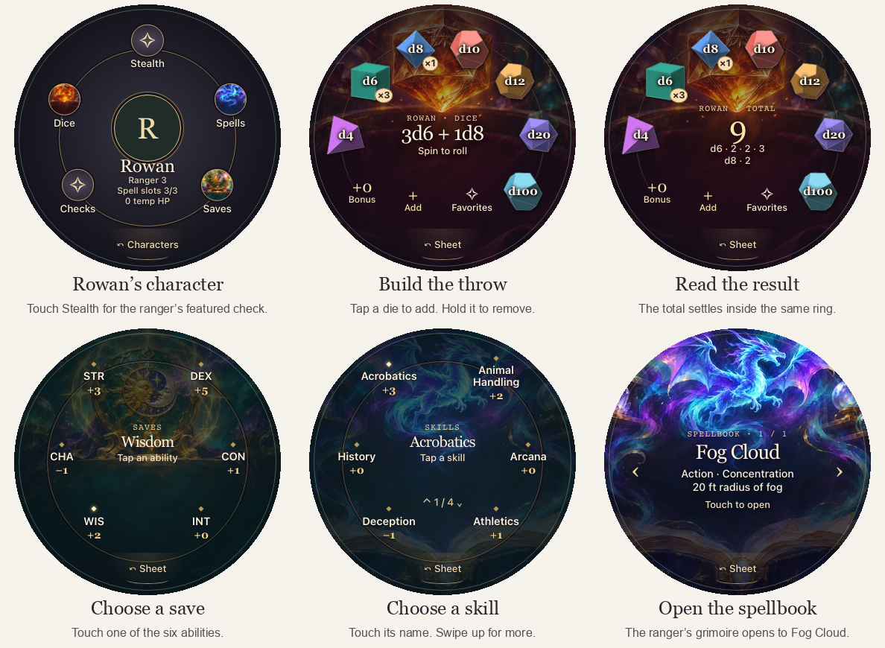

# Screen design previews

These concept images explore future play flows, including featured moves, profile colors and PDF imports. For the gestures and controls available in firmware 0.1.3, follow the [illustrated player manual](MANUAL.md). For implemented mechanics, use the [coverage table](RULES.md#rulebooks-and-expansions-in-firmware-015).

A returning player lands on **their character**. A signature move occupies the top
of the face. The portrait opens the profile, imported class resources and source
status. Touch a landmark around it to play. A right swipe returns to the parent,
and the notch at six o’clock names a touch alternative. Switching characters
brings back that player's featured move, spell choices, skill training and dice tray.

The installed firmware includes sheets, checks, saves, mixed dice and imported spells and actions with base attack and single-formula rolls. Swipe the sheet sideways for the second pair or tap its portrait for Dice. A third pair opens Magic and Rest. Casting, individual spell rolls, point conversions and rest previews are installed. Featured moves and Hit Dice expenditure below are design previews. The fourth pair opens Health and Effects. The fifth opens Pack and Turn in the 0.1.3 development build.

## A turn on the character’s dial

| At the table | Gesture and result |
| --- | --- |
| “I use my usual move.” | Touch the top landmark. A warlock can feature a multi-beam attack and see the beam count and casting cost immediately. A ranger can put Stealth in that spot and open the roll with their own bonus. Hold a spell, skill or save to feature it for that character. |
| “Make a Wisdom save.” | Touch **Saves**, then **WIS** among the six names. Swipe up toward advantage or down toward disadvantage, or touch a mode. Spin to roll. The result shows the kept die and that character’s save modifier. |
| “What do I know about this?” | Touch **Checks**, then **History** or **Arcana** on the first face. Swipe up for the next six skills, swipe down to return, or turn to browse. The fourth face offers plain ability checks. On a skill result, the calculation shows the ability contribution and applicable proficiency. |
| “Roll 3d6 + 1d8.” | Tap the sheet portrait or the center die in Checks or Saves. Tap d6 three times and d8 once. A continuous hold removes one die every half-second. **Remove** lets you subtract with taps. Spin once to roll the pool. A numbered d20 tumbles faster with a quicker turn. Tapping the pool also rolls it. Swipe up for more faces, or tap the total to edit the mix. |
| “I cast a spell.” | Open the illustrated grimoire. Brush up or down over the page or turn the ring to browse this character’s spells. Touch the spell, inspect the available pool and projected effect, then cast. |
| “My attacks go to different targets.” | Assign a target to each beam, roll its attack and roll damage on a confirmed hit. For a dart spell, select the slot and divide the resulting darts before rolling their damage. A save-based area spell shows the DC and damage outcomes for each target’s save. |
| “Let me back out.” | Swipe right from the body of the face, even when your finger starts on a die. Swipe up or down in selectors to browse. Where a return makes sense, the destination is also visible at six o’clock. |

The review uses character snapshots. A real import must honor save and skill
overrides, expertise and conditional bonuses before its totals can be described
as sheet-verified. The skill names and their usual abilities follow the
[2024 rules for checks and saves](https://www.dndbeyond.com/sources/dnd/br-2024/playing-the-game).

The earlier [setup and casting storyboard](screens/table-flow.png) records the
initial navigation study. The six illustrated faces above show the current touch
design. The [hardware profile](HARDWARE.md) gives the memory budgets and native
review procedure.

On the installed picker the top arc shows the connected SSID, position in the library and power. Tap that rim sector for device status. Across the bottom arc, **Phone setup** is reachable along the curve. The central disk opens the character. The character name follows the upper half of the portrait. Class names and levels wrap around the lower half of the portrait. On the sheet, level and proficiency curve above the name and the cache status sits above the refresh action.

## Getting a character onto the dial

| When | What the player sees and does |
| --- | --- |
| First power-on | A teal dragon eye emerges from the dark, embers cross the scales and the title appears below the eye. The empty library offers **Add character**. The player can skip the animation. Reduced motion shows the still illustration. |
| Add from a phone | The dial shows how to join local setup. Paste a D&D Beyond character link on the phone, or choose an exported character PDF. Review the name, classes, portrait and any fields needing attention. Save to the dial. |
| Another session | After the short boot animation, the last character opens from storage. Wi-Fi can connect in the background. Waking during a session skips the animation and consumes the first touch or turn. |
| Another character | Tap **Characters**. The linked profile icon sits in the center circle, over this character’s uploaded background when both are enabled. Turn a detent, swipe vertically, or tap a side arrow to browse. The name, classes and position change together. Tap the portrait to change the active character. Browsing alone leaves the current session in place. |
| Another link to the same character | The import review identifies the existing sheet by source ID and offers to update it. The character keeps its local session, appearance and place in the library. |

## Making a character look like yours

1. Keep the D&D Beyond avatar in its own centered 128 × 128 circle. A separate 360 × 360 background belongs to this character. The player can drag and zoom one uploaded picture in phone setup and choose whether the picker shows the icon, background or both.
2. Suggest two accent swatches from the picture. For a night portrait with blue scales and candlelight, offer a lifted blue and a warm gold. Brighten the swatches for use against the dark face. Give body text its own high-contrast color.
3. Open **Portrait → Theme**. Turn the ring to preview the swatches on the actual face. **Mix color** gives the ring control of the hue. Tap **Use color** to keep it or **Cancel** to return to the saved choice.
4. If the image is absent or fails to load, show a centered initial crest and two preset accents. Keep any previously cached portrait on a failed download. Let the player replace the art independently of the source link. A manual color or portrait stays pinned across refreshes. **Use portrait colors** can return the character to automatic theming.

Use accent color for identity and selection. Use a number, icon or label as
well as color for mechanical states such as low HP or a spent slot.

## Refresh during a game

| What happens | What the player experiences |
| --- | --- |
| Check the link | **Portrait → Refresh → Check link** shows progress. The current sheet stays usable. The player can go straight to **Characters** while it runs. |
| A change arrives | Show a short review for the requesting character, such as “One spell added”. Tap **Apply sheet update** or leave it for later. Show the local slot count alongside the change. |
| The player has switched | Finish the request against its original character ID. Keep the newly opened sheet on screen. The first character’s update waits there for review. |
| No connection, inaccessible sheet or missing portrait | Show the reason and keep the cached sheet and last successful refresh time. Offer retry. For a first import with no cache, offer PDF import or manual setup. Missing art alone does not block import. |
| A source value conflicts with play | Show both values and keep the local one by default. An update to a spell list should never silently refund the slot the player just spent. |

## What the player reaches from the sheet

| Prompt at the table | Touch and ring flow | What stays visible |
| --- | --- | --- |
| “Give me a Wisdom save.” | **Saves → Wisdom**. Tap normal, advantage or disadvantage, then spin to roll. A pinned save opens directly. | Total, kept die and applicable modifiers. A physical-dice entry can replace the generated roll. |
| “I cast this.” | **Spells → spell → eligible pool → Cast**. For a multiclass caster, show ordinary and Pact slots with level and availability. A cantrip skips slot selection. | Cast time, cost before spending, remaining uses and Undo. |
| “Does that attack hit?” | **Actions → attack → Roll**. Confirm a hit, critical or miss before rolling damage. | Attack total first, then damage components and their types. |
| “Take 12 damage.” | **Combat → turn left to 12 → Apply**. A touch adjustment is available. | Pending change, temp HP absorbed, remaining HP and Undo. Offer a concentration save when applicable. |
| “Can I still do something this turn?” | **My Turn → action, bonus action or reaction**. Tap a favorite or inspect why it is unavailable. | Cost, remaining uses and active effects. |
| “How long is that effect active?” | **Effects → effect**. Turn to browse. Tap to end or advance the applicable turn counter. | Source, target, duration and concentration. |
| “What can my familiar do?” | **Character → Companions → companion**. Tap its HP or an action. | The companion’s name stays on screen with its own HP and uses. |
| “We take a short rest.” | **Resources → Rest → Short**. Select hit dice, preview recoveries, then apply. | Recovery by pool, dice spent and Undo. A long rest uses the chosen rules edition. |
| “What did I just spend?” | Open **Log** from the menu or pull down from the top edge. | Most recent cast, damage, roll or resource change and any available Undo. |

The interactive review exercises the library, appearance, refresh, spell
resolution, mixed dice and a saving throw. The other rows specify how the larger feature list
fits around those screens. The detailed rules live in the [feature list](FEATURES.md).

## Touch, feedback and graphics

- Keep important targets near the center of the round face. Start with roughly 44–48 display pixels per touch target, then try them with a thumb on the physical screen. Give swipes a visible button equivalent. Cancel the tap once a drag becomes a swipe.
- On the picker, turning changes the candidate. In a list it scrolls. In a focused number or hue it changes that value. Moving to another page clears the previous dial focus. Touch confirms. The design requires only single-finger gestures and ring rotation.
- Keep browsing quiet. Propose one light pulse for opening a sheet or saving a color, a firmer pulse for committing a cast, and a distinct double pulse for an actionable error on the active screen. Pair each with visible feedback. Allow vibration to be disabled. The entire journey works with the speaker disconnected.
- Target about one second of motion at boot, with immediate skip and a still version. Reuse the dice-tray artwork with one small animated glint. During play redraw only the changed value, focus or portrait area. Cache the current thumbnail and prepare the next one instead of decoding an entire library at once.
- Waveshare lists a 360 × 360 capacitive LCD, ring encoder, DRV2605 vibration driver, 2.4 GHz Wi-Fi, 8 MB PSRAM and 16 MB flash. A 160 × 160 RGB565 thumbnail needs 50 KiB decoded. A 360 × 360 RGB565 frame needs about 253 KiB. Downsample large source pictures during import and store the small result. Keep a cached image or crest available while downloading. [Board documentation](https://www.waveshare.com/wiki/ESP32-S3-Knob-Touch-LCD-1.8)

The illustrations establish navigation and visual hierarchy. Thumb reach at the
edge, encoder direction, motor patterns, boot timing, image decoding alongside
Wi-Fi and text legibility at arm’s length still need a check on the actual unit.
